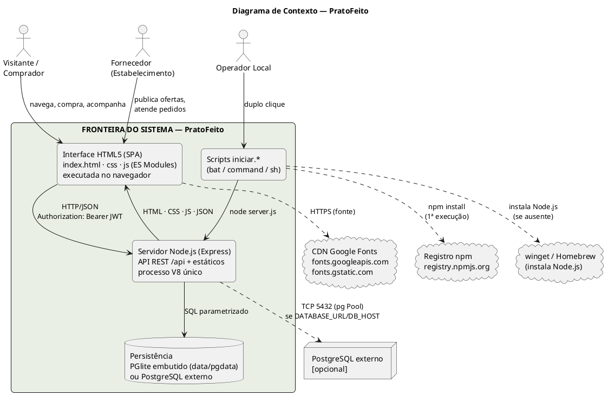
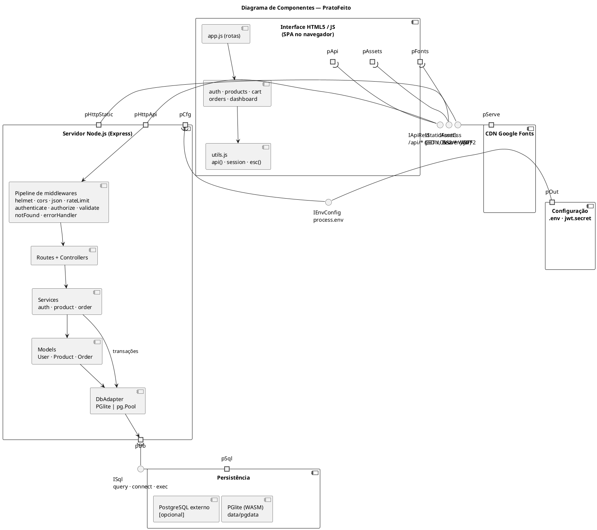
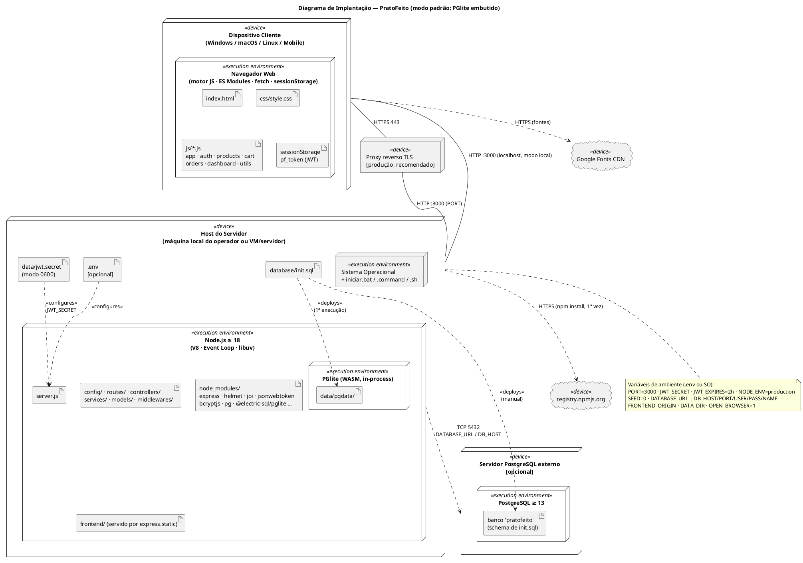

# Declaração de Escopo do Projeto — PratoFeito

| Campo | Valor |
|---|---|
| **Projeto** | PratoFeito — marketplace de alimentos próximos ao vencimento (desconto e doação) |
| **Release** | 1.0 (`pratofeito-backend` 1.0.0) |
| **Versão do documento** | 1.0 |
| **Referenciais** | PMBOK® Guide 7ª Ed. (Domínios de Desempenho: Partes Interessadas, Equipe, Abordagem de Desenvolvimento e Ciclo de Vida, Planejamento, Trabalho do Projeto, Entrega, Medição, Incerteza); OMG UML 2.5.1; ISO/IEC/IEEE 29148:2018; ISO/IEC 25010 |
| **Idioma** | Português Brasileiro (pt-BR) |
| **Documentos relacionados** | `requisitos_de_usuario.md` (RU/UC), `requisitos_de_sistema.md` (RSF/RSNF/Lxx) |

> **Nota metodológica.** O escopo foi derivado do código entregue (`pratofeito.zip`). A coluna "Situação" indica o estado **por inspeção estática do código**; nenhum teste automatizado existe e nenhuma execução foi realizada para esta documentação. Datas e esforços não foram informados pelo patrocinador e, por isso, não são inventados aqui: a EAP é orientada a **entregáveis**.

---

## Sumário

1. Justificativa de engenharia e objetivos SMART
2. Fronteiras do sistema e Diagrama de Contexto
3. Escopo do produto por módulos e entregáveis físicos
4. Diagrama de Componentes (portas e interfaces)
5. Diagrama de Implantação
6. Estrutura Analítica do Projeto (EAP/WBS) e dicionário
7. Limites do projeto: Dentro e Fora do Escopo
8. Matrizes: Critérios de Aceitação, Restrições/Premissas e Riscos
9. Governança e controle de mudanças de escopo
10. Partes interessadas

---

## 1. Justificativa de engenharia e objetivos SMART

### 1.1 Problema e oportunidade

Estabelecimentos descartam alimentos ainda próprios para consumo ao se aproximarem da validade, enquanto consumidores e instituições buscam alimentos acessíveis. O PratoFeito conecta os dois lados com ofertas **com desconto** ou **gratuitas (doação)**, retirada local ou entrega, e indicadores de impacto.

### 1.2 Justificativa da stack Node.js + HTML5

| Decisão arquitetural | Justificativa de engenharia | Trade-off assumido |
|---|---|---|
| **Node.js (Event Loop, I/O não bloqueante)** | Carga predominantemente de I/O (HTTP + SQL), com concorrência alta e baixo custo por conexão; um único runtime (JavaScript) em cliente e servidor reduz a carga cognitiva e o custo de manutenção. | Tarefas CPU-bound (bcrypt de custo 12) disputam a *thread* única — mitigado por *rate limit* e implementação assíncrona (risco R-01). |
| **Express 4 + camadas (routes → controllers → services → models)** | Separação de responsabilidades simples, baixa curva de aprendizado, ecossistema maduro de middlewares (Helmet, rate-limit, Joi). | Sem *framework* opinativo: disciplina de camadas depende de convenção. |
| **SPA em HTML5 semântico + CSS3 + JS ES Modules (sem build)** | Zero etapa de compilação, servido pelo mesmo processo (mesma origem ⇒ sem CORS), foco em acessibilidade e leveza. | Sem tipagem estática e sem *framework* reativo; renderização por *template strings* exige disciplina de escape (`esc()`). |
| **PostgreSQL com PGlite embutido** | SQL padrão com transações ACID e `SELECT … FOR UPDATE` para consistência de estoque; PGlite elimina instalação de banco (adoção em 1 clique); mesmo SQL roda em PostgreSQL externo em produção. | PGlite é monoprocesso e serializa consultas — adequado a demonstração/uso local (risco R-05). |
| **JWT *stateless* + bcrypt** | Escalabilidade horizontal sem armazenamento de sessão; senhas com hash adaptativo e *salt* por registro. | Sem revogação de token (L-09). |
| **Lançadores `iniciar.*`** | Reduz a barreira para usuários não técnicos (Windows/macOS/Linux). | Execução de `npm install` externa na primeira vez (risco R-12). |

### 1.3 Objetivos SMART

> Metas de referência para aceitação da Release 1.0. "Mensurável" indica o método de aferição; metas marcadas **[a medir]** exigem testes ainda inexistentes.

| ID | Específico | Mensurável | Atingível | Relevante | Temporal | Estado |
|---|---|---|---|---|---|---|
| OBJ-01 | Permitir iniciar a aplicação completa (servidor + banco + dados demo) com um único clique | Primeira execução ≤ 60 s com internet (conforme `LEIA-ME.txt`); execuções seguintes ≤ 10 s; 0 configurações manuais | Banco embutido e segredo JWT autogerado | Adoção por usuários não técnicos | Até a aceitação da Release 1.0 | Atendido por inspeção; tempo **[a medir]** |
| OBJ-02 | Entregar 100% dos RUs *Must* (14 de 20) pelo SPA e pela API | RU-01, 03, 04, 05, 06, 07, 08, 09, 11, 12, 13, 14, 15, 17 demonstráveis | Escopo enxuto | Valor central do negócio | Release 1.0 | RU-07 e RU-15 parciais (L-11, L-01/02) |
| OBJ-03 | Garantir **zero *overselling*** no checkout sob concorrência | Teste com 50 requisições simultâneas sobre estoque 10 ⇒ exatamente 10 unidades vendidas, 0 estoque negativo | Transação + `FOR UPDATE` já implementados | Integridade financeira e confiança | Release 1.0 | Implementado; teste **[a medir]** |
| OBJ-04 | Segurança: 100% das consultas parametrizadas, 0 senhas em texto puro, 100% das rotas não públicas exigindo JWT e papel | Revisão de código + testes de IDOR/SQLi/XSS | Joi + `$n` + RBAC existentes | Proteção de dados pessoais (LGPD) | Release 1.0 | Atendido por inspeção; testes **[a medir]** |
| OBJ-05 | Desempenho do catálogo | `GET /api/products` p95 < 300 ms com 10.000 produtos em PostgreSQL | Índice + `LIMIT 100` | Experiência do comprador | Release 1.0 | **[a medir]** |
| OBJ-06 | Acessibilidade | Telas principais conformes a WCAG 2.1 AA (foco, contraste, rótulos, navegação por teclado) | Base semântica pronta | Inclusão | Release 1.0 | Contraste **[a medir]** |
| OBJ-07 | Rastreabilidade documental | 100% dos RU ↔ UC ↔ RSF ↔ código mapeados | Documentos 1–3 | Auditoria | Release 1.0 | Atendido (§8.5 de `requisitos_de_sistema.md`) |

---

## 2. Fronteiras do sistema e Diagrama de Contexto

### 2.1 Delimitação (System Boundary)

**Dentro da fronteira (controlado pelo projeto):**
1. **Interface HTML5 client-side** — SPA (`frontend/`), executada no navegador do usuário.
2. **Servidor runtime Node.js** — processo único (Express) que serve a SPA e a API.
3. **Camada de persistência** — PGlite embutido (`data/pgdata`) ou conexão a PostgreSQL externo configurado pelo operador.
4. **Scripts de execução** — `iniciar.bat`, `iniciar.command`, `iniciar.sh`.

**Fora da fronteira (dependências externas):**
Navegador/SO do usuário, CDN Google Fonts, registro npm, `winget`/Homebrew, instância PostgreSQL externa (quando usada), proxy reverso/TLS de produção.

### 2.2 Diagrama de Contexto

### 2.3 Fluxos de dados cruzando a fronteira

| Origem → Destino | Dados | Protocolo | Controle de segurança |
|---|---|---|---|
| Navegador → Servidor | Credenciais, cadastro, pedidos, produtos, status | HTTP/JSON (TLS via proxy em produção) | Helmet, rate limit (`/api/auth`), Joi, JWT, RBAC |
| Servidor → Navegador | HTML/CSS/JS estáticos, JSON `{success,data}` | HTTP | CSP, escape de saída no cliente |
| Servidor → Persistência | SQL com parâmetros | In-process (PGlite) / TCP (pg) | Prepared statements `$n`, `CHECK`, FKs |
| Navegador → Google Fonts | Requisição de fonte (IP/UA do usuário) | HTTPS | CSP permite `https:` em `style-src`/`font-src`; fonte tem *fallback* |
| Operador → Sistema | Execução de scripts | Local | Nenhum privilégio especial (exceto instalação do Node.js) |

---

## 3. Escopo do produto por módulos arquiteturais e entregáveis físicos

### 3.1 Visão geral dos módulos

| Mód. | Nome | Responsabilidade | RUs atendidos |
|:-:|---|---|---|
| M1 | Execução e Configuração | Inicialização em 1 clique, configuração, ciclo de vida do processo | RU-17, RU-18 |
| M2 | Persistência | Esquema, adaptador dual de banco, carga de demonstração | RU-17 |
| M3 | Identidade e Acesso | Cadastro, login, JWT, RBAC, perfil | RU-03…RU-06 |
| M4 | Catálogo e Fornecimento | Listagem pública e gestão de ofertas | RU-01, 02, 11, 12, 13, 16, 20 |
| M5 | Pedidos | Carrinho, checkout transacional, acompanhamento, status, painel | RU-07…RU-10, RU-14, RU-15 |
| M6 | Transversal de Servidor | Validação, tratamento de erros, segurança HTTP | RU-03…RU-15 |
| M7 | Interface SPA | Shell HTML, roteamento por hash, estilos, utilitários, toasts | RU-01…RU-16 |

### 3.2 Entregáveis físicos de código por módulo

#### M1 — Execução e Configuração
| Arquivo | Tipo | Função |
|---|---|---|
| `iniciar.bat` | Script batch | Windows: detecta/instala Node.js (winget), `npm install`, `node server.js` |
| `iniciar.command` | Script shell | macOS: duplo clique |
| `iniciar.sh` | Script shell | Linux/macOS: Homebrew opcional, `npm install`, `node server.js` |
| `LEIA-ME.txt` | Documento | Instruções ao usuário final |
| `ecommerce-backend/server.js` | Código | Composição do app, pipeline de middlewares, escuta de porta, instância única, encerramento gracioso |
| `ecommerce-backend/config/env.js` | Código | Carga de `.env`, `DATA_DIR`, geração de `jwt.secret` |
| `ecommerce-backend/package.json` | Manifesto | Dependências e *scripts* `start`/`dev` |
| `ecommerce-backend/.env.example` | Modelo | Variáveis opcionais documentadas |
| `ecommerce-backend/.gitignore` | Config. | Exclui `node_modules/`, `data/`, `.env` |
| `ecommerce-backend/README.md` | Documento | Guia técnico resumido |

#### M2 — Persistência
| Arquivo | Tipo | Função |
|---|---|---|
| `config/db.js` | Código | Adaptador dual (PGlite com fila / `pg.Pool` max 10) |
| `database/init.sql` | Script DDL | Tipos, tabelas, constraints, sequência, índice |
| `database/bootstrap.js` | Código | Criação do esquema na 1ª execução e *seed* de demonstração |
| `data/pgdata/` *(gerado)* | Dados | Armazenamento do PGlite |
| `data/jwt.secret` *(gerado)* | Segredo | Chave de assinatura JWT (modo 0600) |

#### M3 — Identidade e Acesso
| Arquivo | Camada | Função |
|---|---|---|
| `routes/auth.routes.js` | Rota | `POST /register`, `POST /login` |
| `controllers/auth.controller.js` | Controller | `wrap` + códigos 201/200 |
| `services/auth.service.js` | Service | bcrypt (custo 12), JWT, conflito de e-mail |
| `models/User.js` | Model | `findByEmail`, `findById`, `create` |
| `routes/users.routes.js`, `controllers/user.controller.js` | Rota/Controller | `GET /users/me` |
| `middlewares/auth.middleware.js` | Middleware | `authenticate`, `authorize` |
| `frontend/js/auth.js` | Front | Formulários de login/cadastro, logout |

#### M4 — Catálogo e Fornecimento
| Arquivo | Camada | Função |
|---|---|---|
| `routes/products.routes.js` | Rota | 6 rotas (`/`, `/mine`, `/:id`, `POST`, `PUT`, `DELETE`) |
| `controllers/product.controller.js` | Controller | Delegação ao serviço |
| `services/product.service.js` | Service | Regras e 404 |
| `models/Product.js` | Model | SQL parametrizado, filtros dinâmicos seguros |
| `frontend/js/products.js` | Front | Catálogo, filtros, adição ao carrinho |
| `frontend/js/dashboard.js` | Front | Painel; publicar e desativar produtos |

#### M5 — Pedidos
| Arquivo | Camada | Função |
|---|---|---|
| `routes/orders.routes.js` | Rota | `GET /`, `POST /`, `PATCH /:id/status` |
| `controllers/order.controller.js` | Controller | Checkout, listagem, status |
| `services/order.service.js` | Service | Transação com bloqueio de linhas |
| `models/Order.js` | Model | Listagens por papel; atualização condicionada |
| `frontend/js/cart.js` | Front | Carrinho em memória e checkout |
| `frontend/js/orders.js` | Front | Lista de pedidos e seletor de status |

#### M6 — Transversal de Servidor
| Arquivo | Função |
|---|---|
| `middlewares/validate.js` | Esquemas Joi (`register`, `login`, `product`, `order`, `status`) e *factory* `validate` |
| `middlewares/error.middleware.js` | `AppError`, `notFound`, `errorHandler` |

#### M7 — Interface SPA
| Arquivo | Função |
|---|---|
| `frontend/index.html` | Shell semântico: `<header>`, `<nav>`, `<main>`, região `#toast` |
| `frontend/css/style.css` | Design tokens (variáveis CSS), layout responsivo, foco visível, `prefers-reduced-motion` |
| `frontend/js/app.js` | Roteamento por hash, guarda de rotas protegidas, menu |
| `frontend/js/utils.js` | `api()`, `session`, `esc()`, `money()`, `date()`, `toast()`, `form()` |
| `frontend/assets/` | Diretório reservado (vazio) |

### 3.3 Totalização

| Item | Quantidade |
|---|:-:|
| Arquivos-fonte do backend (`.js`) | 24 |
| Arquivos do frontend (`.html`, `.css`, `.js`) | 10 |
| Script SQL | 1 |
| Scripts de execução | 3 |
| Rotas HTTP de API | 14 |

---

## 4. Diagrama de Componentes (UML 2.5.1)

Componentes com **portas** (`port`), **interfaces providas** (⊸ lollipop) e **requeridas** (socket). Nomes de interface seguem o padrão `I<Nome>`.

### 4.1 Especificação das interfaces

| Interface | Provida por (porta) | Requerida por (porta) | Contrato |
|---|---|---|---|
| **IStaticAssets** | Servidor — `pHttpStatic` | SPA — `pAssets` | `GET /` → `index.html`; `/css/*`, `/js/*`; *middleware* `express.static` |
| **IApiRest** | Servidor — `pHttpApi` | SPA — `pApi` | 14 rotas REST (`requisitos_de_sistema.md` §8); envelope `{success,data|error}`; `Authorization: Bearer` |
| **ISql** | Persistência — `pSql` | Servidor — `pDb` | `query(text, params)`, `connect()`, `exec(sql)`, `init()`, `close()`; dialeto PostgreSQL; parâmetros `$n` |
| **IFontCss** | CDN Google Fonts | SPA — `pFonts` | CSS2 `Bricolage Grotesque` (400/600/800), `display=swap` |
| **IEnvConfig** | Configuração | Servidor — `pCfg` | `PORT`, `JWT_SECRET`, `JWT_EXPIRES`, `NODE_ENV`, `SEED`, `DATABASE_URL`, `DB_*`, `FRONTEND_ORIGIN`, `DATA_DIR`, `OPEN_BROWSER` |

### 4.2 Regras de dependência (arquitetura em camadas)

| Regra | Descrição |
|---|---|
| D-01 | Dependências fluem apenas "para baixo": Rotas → Controllers → Services → Models → DbAdapter. |
| D-02 | A SPA **não** acessa o banco; toda leitura/escrita passa por `IApiRest`. |
| D-03 | SQL existe somente em `models/*.js`, `bootstrap.js` e `order.service.js` (transação de checkout). |
| D-04 | Segredos (`JWT_SECRET`) nunca trafegam ao cliente. |

---

## 5. Diagrama de Implantação (UML 2.5.1)

### 5.1 Mapeamento de artefatos para nós

| Artefato | Nó de implantação | Observações |
|---|---|---|
| `index.html`, `css/`, `js/` | Servidor → baixados para o Navegador | Executam no cliente; sem etapa de *build* |
| `server.js` e pastas do backend | Host / Node.js | Processo único; porta `PORT` (padrão 3000, recua até +10) |
| `node_modules/` | Host | Criado por `npm install` (1ª execução) |
| `.env` | Host | Opcional; **não versionar** |
| `data/jwt.secret` | Host | Gerado automaticamente; permissão 0600; **não versionar**; apagar `data/` invalida tokens |
| `data/pgdata/` | Host / PGlite | Banco embutido; instância única por diretório |
| `database/init.sql` | Host (e manual no PG externo) | Aplicado automaticamente apenas no PGlite ou no PG externo quando a tabela `users` não existe |
| `pf_token` | Navegador (`sessionStorage`) | Escopo de aba |

### 5.2 Perfis de implantação

| Perfil | Banco | `NODE_ENV` | Seed demo | TLS | Uso |
|---|---|---|:-:|---|---|
| **Demonstração local** (padrão) | PGlite | (vazio) | Sim | Não | Avaliação, apresentação |
| **Servidor de homologação** | PostgreSQL externo | `development` | Opcional (`SEED=0`) | Proxy | Testes de integração |
| **Produção** | PostgreSQL externo | `production` | **Não** | **Proxy obrigatório** | Uso real; definir `JWT_SECRET` forte; ver L-08, L-23 |

---
