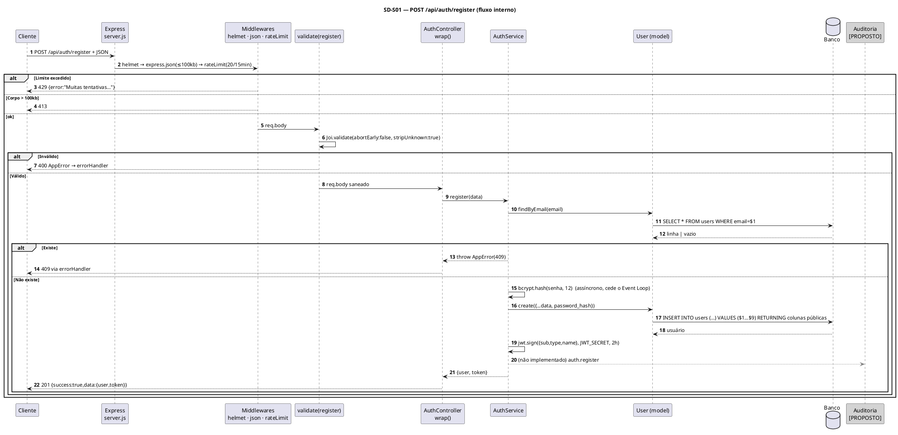
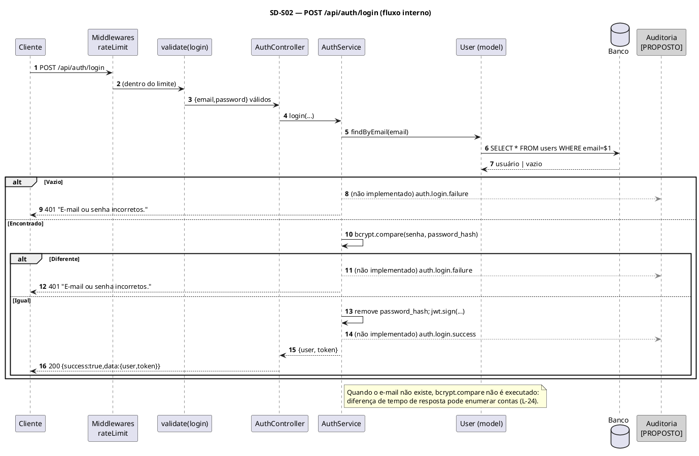
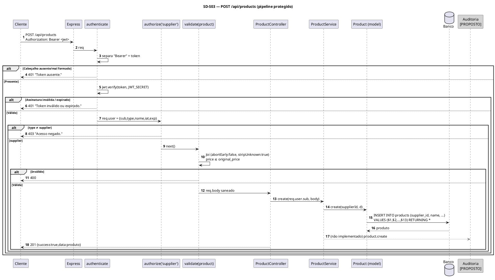
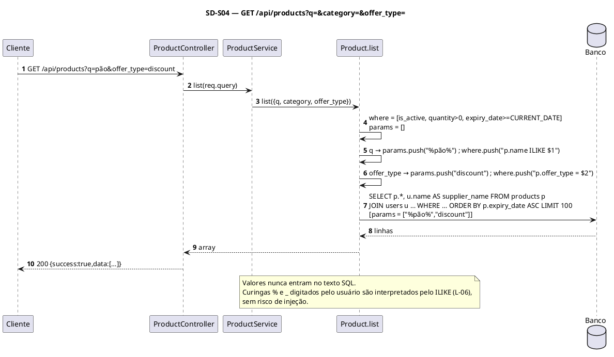
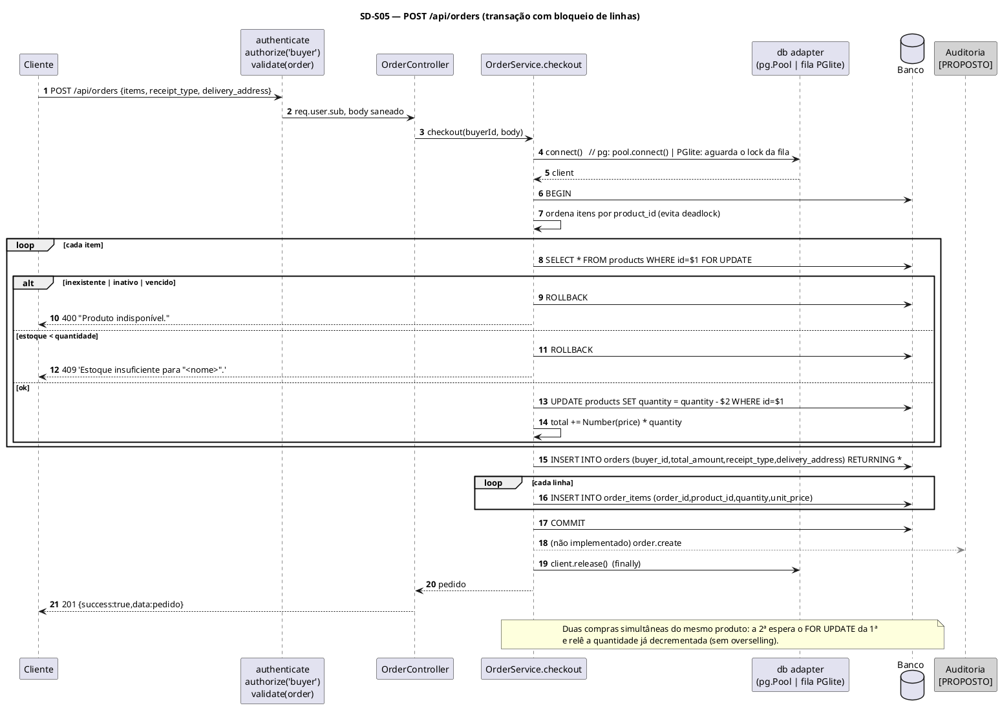
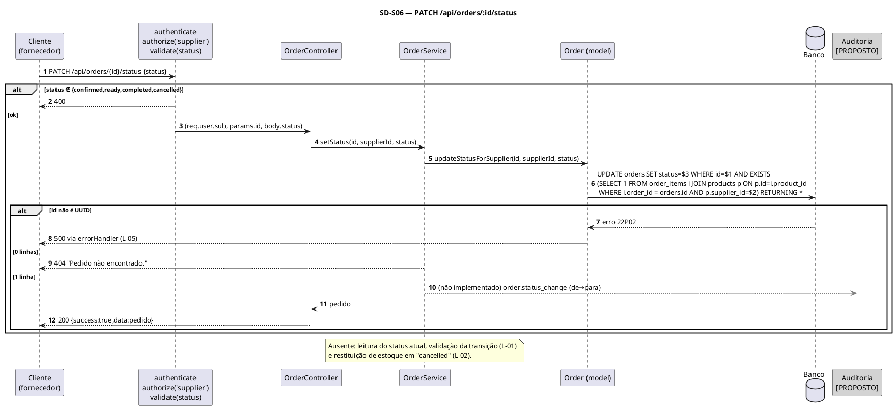
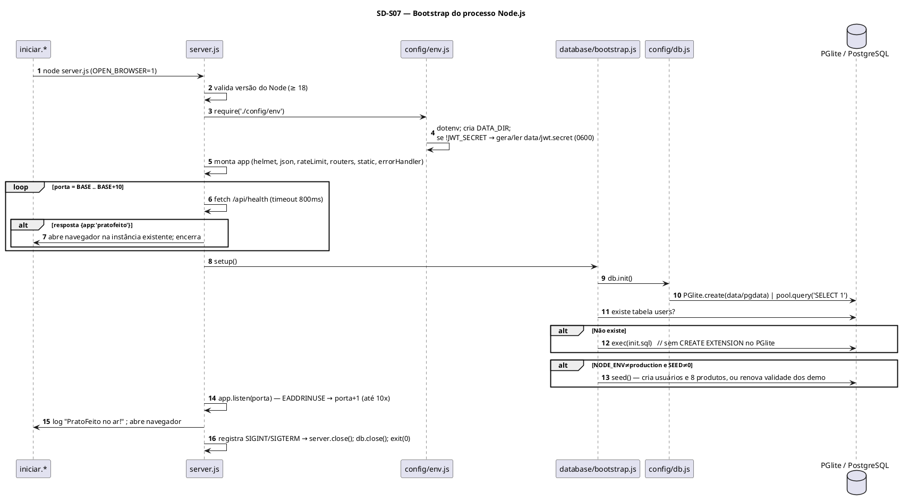
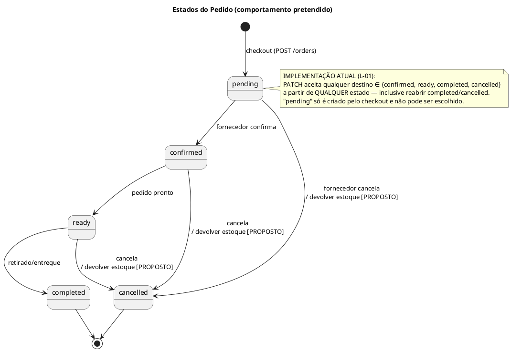
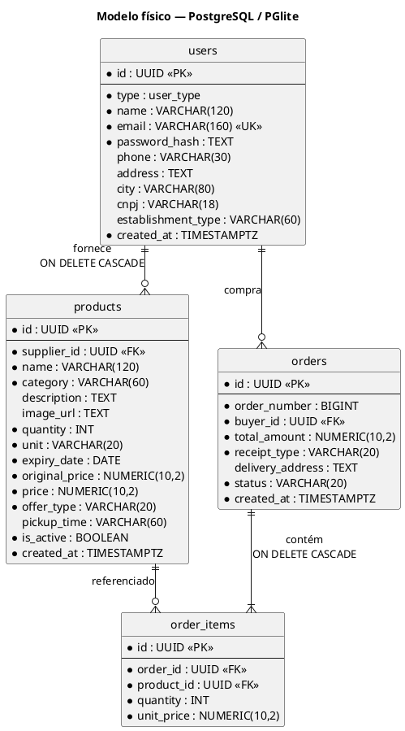

# Documento de Requisitos de Sistema — PratoFeito

| Campo | Valor |
|---|---|
| **Sistema** | PratoFeito — API REST + SPA servidos por um único processo Node.js |
| **Versão do documento** | 1.0 |
| **Versão do sistema analisado** | `pratofeito-backend` 1.0.0 (`engines.node >= 18`) |
| **Normas de referência** | OMG UML 2.5.1; OMG OCL 2.4; ISO/IEC/IEEE 29148:2018; ISO/IEC 25010; FURPS+ |
| **Idioma** | Português Brasileiro (pt-BR) |
| **Documentos relacionados** | `requisitos_de_usuario.md`, `escopo_do_projeto.md` |

> **Nota metodológica.** Documento obtido por engenharia reversa do código entregue. Itens descritos como "Implementado" foram verificados no código-fonte. Itens **[PROPOSTO]** não existem no código e são recomendações para auditoria/evolução. O banco de dados efetivamente usado é **PGlite (PostgreSQL embutido, WASM)** por padrão ou **PostgreSQL** externo; **não há SQLite** neste projeto, e o dialeto de todas as consultas é PostgreSQL (`$1`, `ILIKE`, `json_agg`, `FOR UPDATE`, `gen_random_uuid()`).

---

## Sumário

1. Arquitetura de runtime e pilha tecnológica
2. Requisitos Funcionais de Sistema (RSF)
3. Requisitos Não Funcionais (RSNF) — FURPS+ / ISO 25010
4. Diagramas de Sequência de backend
5. Diagrama de Classes de Domínio e Controladores (com OCL)
6. Máquina de estados do Pedido
7. Dicionário Técnico de Dados (DDL)
8. Contratos de API RESTful e Matriz de Rastreabilidade
9. Registro de Lacunas e Dívida Técnica (L-01 … L-25)

---

## 1. Arquitetura de runtime e pilha tecnológica

### 1.1 Pilha

| Camada | Tecnologia | Versão (package.json) | Papel |
|---|---|---|---|
| Runtime | Node.js | ≥ 18 (verificado em `server.js`) | Event Loop single-thread, I/O não bloqueante |
| Servidor HTTP | Express | ^4.19.2 | Roteamento, middlewares, arquivos estáticos |
| Cabeçalhos de segurança | Helmet | ^7.1.0 | CSP e *headers* defensivos |
| Limitação de taxa | express-rate-limit | ^7.4.0 | 20 req/15 min por IP em `/api/auth` |
| CORS | cors | ^2.8.5 | Ativado **somente** se `FRONTEND_ORIGIN` definido |
| Validação | Joi | ^17.13.3 | Esquemas de entrada |
| Hash de senha | bcryptjs | ^2.4.3 | bcrypt em JS puro, custo 12 |
| Tokens | jsonwebtoken | ^9.0.2 | JWT (HS256 padrão) |
| Banco embutido | @electric-sql/pglite | ^0.3.0 | PostgreSQL em WASM, dados em `data/pgdata` |
| Banco externo | pg | ^8.12.0 | Pool de conexões (`max: 10`) |
| Configuração | dotenv | ^16.4.5 | `.env` opcional |
| Frontend | HTML5 + CSS3 + ES Modules | — | SPA com roteamento por hash |

### 1.2 Camadas lógicas (backend)

```
Requisição HTTP
   │
   ▼
server.js ── helmet → [cors] → express.json(100kb) → /api/health → rateLimit(/api/auth)
   │
   ▼
routes/*.routes.js ── authenticate → authorize(papéis) → validate(schema)
   │
   ▼
controllers/*.controller.js ── wrap(fn,código) → { success:true, data }
   │
   ▼
services/*.service.js ── regras de negócio, transações, bcrypt, JWT
   │
   ▼
models/*.js ── SQL parametrizado ($1…$n)
   │
   ▼
config/db.js ── adaptador: PGlite (fila/mutex) | pg.Pool (max 10)
   │
   ▼
Banco (data/pgdata  |  PostgreSQL externo)
```

`UserController.me` é a exceção: acessa o *model* diretamente (sem camada de serviço).

### 1.3 Ordem exata dos middlewares (`server.js`)

| # | Middleware | Escopo | Efeito |
|:-:|---|---|---|
| 1 | `helmet({ contentSecurityPolicy: … })` | global | Aplica CSP padrão do Helmet com `upgrade-insecure-requests` desativado (permite HTTP em `localhost`) e demais cabeçalhos defensivos |
| 2 | `cors({ origin: FRONTEND_ORIGIN, allowedHeaders: ['Content-Type','Authorization'] })` | global, **condicional** | Só quando `FRONTEND_ORIGIN` existe; por padrão a mesma origem dispensa CORS |
| 3 | `express.json({ limit: '100kb' })` | global | *Parser* JSON; corpo > 100 kB → erro 413 |
| 4 | `GET /api/health` | rota | Responde `{ success:true, data:{ app:'pratofeito' } }` |
| 5 | `rateLimit({ windowMs: 15min, max: 20 })` | `/api/auth` | 429 com mensagem em pt-BR; envia cabeçalhos padrão `RateLimit-*` |
| 6 | Routers: `/api/auth`, `/api/products`, `/api/orders`, `/api/users` | rotas | Ver §2 |
| 7 | `notFound` | `/api/*` | 404 JSON "Rota não encontrada." |
| 8 | `express.static(../frontend)` | global | Serve o SPA (`index.html`, `css/`, `js/`) |
| 9 | `errorHandler` | global | Normaliza erros; oculta detalhes em 500 |

---

## 2. Requisitos Funcionais de Sistema (RSF)

**Convenções.** Envelope de resposta: sucesso `{ "success": true, "data": … }`; falha `{ "success": false, "error": "mensagem" }`. `Content-Type: application/json`. Rotas protegidas exigem `Authorization: Bearer <JWT>`. Todas as rotas da API têm prefixo `/api`.

### 2.1 Catálogo resumido

| ID | Requisito | Rota / Componente | Origem (RU) | Situação |
|---|---|---|---|---|
| RSF-01 | Servir o frontend estático na mesma origem | `express.static` | RU-01…RU-17 | Implementado |
| RSF-02 | Verificação de saúde / identificação da instância | `GET /api/health` | RU-17 | Implementado |
| RSF-03 | Cadastro de usuário | `POST /api/auth/register` | RU-03, RU-04 | Implementado |
| RSF-04 | Autenticação | `POST /api/auth/login` | RU-05 | Implementado |
| RSF-05 | Listagem pública de produtos com filtros | `GET /api/products` | RU-01, RU-02 | Implementado |
| RSF-06 | Detalhe de produto | `GET /api/products/:id` | — (sem UI) | Implementado |
| RSF-07 | Listagem de produtos do fornecedor | `GET /api/products/mine` | RU-12 | Implementado |
| RSF-08 | Criação de produto | `POST /api/products` | RU-11 | Implementado |
| RSF-09 | Atualização de produto | `PUT /api/products/:id` | RU-20 | Implementado (sem UI) |
| RSF-10 | Desativação lógica de produto | `DELETE /api/products/:id` | RU-13 | Implementado |
| RSF-11 | Criação transacional de pedido | `POST /api/orders` | RU-08 | Implementado |
| RSF-12 | Listagem de pedidos por papel | `GET /api/orders` | RU-09, RU-10, RU-14 | Implementado |
| RSF-13 | Atualização de status do pedido | `PATCH /api/orders/:id/status` | RU-15 | Parcial (L-01, L-02) |
| RSF-14 | Consulta do perfil autenticado | `GET /api/users/me` | — (sem UI) | Implementado |
| RSF-15 | Autenticação por JWT (middleware) | `authenticate` | RU-05…RU-16 | Implementado |
| RSF-16 | Autorização por papel (RBAC) | `authorize(...roles)` | RU-08, RU-11…RU-15 | Implementado |
| RSF-17 | Validação e saneamento de payload | `validate(schema)` | RU-03, RU-04, RU-08, RU-11, RU-15 | Implementado |
| RSF-18 | Tratamento centralizado de erros | `errorHandler` | todos | Implementado |
| RSF-19 | Resposta 404 para rotas `/api` inexistentes | `notFound` | todos | Implementado |
| RSF-20 | Criação do esquema e carga de demonstração | `database/bootstrap.js` | RU-17 | Implementado |
| RSF-21 | Configuração e geração de segredo JWT | `config/env.js` | RU-17 | Implementado |
| RSF-22 | Ciclo de vida do servidor | `server.js` | RU-17, RU-18 | Implementado |
| RSF-23 | Adaptador de banco dual (PGlite / pg) | `config/db.js` | RU-17 | Implementado |
| RSF-24 | Trilha de auditoria | — | — | **[PROPOSTO] (L-03)** |
| RSF-25 | Imposição da máquina de estados do pedido | — | RU-15 | **[PROPOSTO] (L-01, L-02)** |

### 2.2 Especificação detalhada

#### RSF-01 — Servir frontend estático
- `app.use(express.static(path.join(__dirname,'..','frontend')))`, registrado **após** o `notFound` da API.
- `GET /` retorna `frontend/index.html`; ativos: `/css/style.css`, `/js/*.js` (módulos ES). Não existe *fallback* de SPA: o roteamento é por hash (`#/…`), portanto o servidor nunca recebe as sub-rotas.
- Aceite: `GET /` → 200 `text/html`; `GET /js/app.js` → 200 `application/javascript`.

#### RSF-02 — `GET /api/health`
- Público, sem *rate limit*. Resposta `200 {"success":true,"data":{"app":"pratofeito"}}`.
- Usado por `server.js` (`isOurs`) para detectar instância já em execução (timeout 800 ms).

#### RSF-03 — `POST /api/auth/register`
- **Pipeline:** `helmet → express.json → rateLimit → validate(register) → AuthController.register → AuthService.register → User.findByEmail → bcrypt.hash(12) → User.create → jwt.sign`.
- **Request**
```json
{
  "type": "supplier",
  "name": "Padaria Bom Dia",
  "email": "contato@bomdia.com",
  "password": "senhaSegura123",
  "phone": "(00) 90000-0000",
  "address": "Rua Exemplo, 100",
  "city": "Cidade Exemplo",
  "cnpj": "12.345.678/0001-90",
  "establishment_type": "Padaria"
}
```
- **Esquema Joi:** `type` ∈ {buyer, supplier} *obrigatório*; `name` 2–120 *obrigatório*; `email` válido *obrigatório*; `password` 8–72 *obrigatório* (72 = limite de bytes do bcrypt); `phone` ≤ 30; `address` ≤ 255; `city` ≤ 80 (todos aceitam `''`/`null`); `cnpj` — se `type = supplier`, *obrigatório* e deve casar `/^[\d./-]{14,18}$/`, caso contrário é removido (`Joi.any().strip()`); `establishment_type` ≤ 60. Campos desconhecidos são descartados (`stripUnknown`).
- **Respostas**

| Código | Condição | Corpo |
|:-:|---|---|
| 201 | Criado | `{"success":true,"data":{"user":{…sem password_hash…},"token":"<jwt>"}}` |
| 400 | Falha de validação | `{"success":false,"error":"\"email\" must be a valid email; …"}` (mensagens Joi em inglês — L-19) |
| 409 | E-mail já cadastrado (verificação prévia **ou** violação `UNIQUE` `23505`) | `"E-mail já cadastrado."` / `"Registro já existe."` |
| 413 | Corpo > 100 kB | erro padrão do *body-parser* |
| 429 | > 20 requisições/15 min/IP | `"Muitas tentativas. Tente novamente em 15 minutos."` |
| 500 | Falha interna | `"Erro interno do servidor."` |

#### RSF-04 — `POST /api/auth/login`
- **Request** `{"email":"…","password":"…"}` (ambos obrigatórios).
- **Pipeline:** `rateLimit → validate(login) → AuthService.login → User.findByEmail → bcrypt.compare → jwt.sign`.
- **Token:** payload `{ sub: <uuid>, type: "buyer"|"supplier", name, iat, exp }`; `expiresIn = JWT_EXPIRES || '2h'`; assinado com `JWT_SECRET`.
- **Respostas:** `200 {data:{user,token}}`; `400` validação; `401 "E-mail ou senha incorretos."` (mesma mensagem para usuário inexistente e senha errada); `429`; `500`.

#### RSF-05 — `GET /api/products`
- Público. **Query:** `q` (nome, `ILIKE %q%`), `category` (igualdade), `offer_type` (igualdade).
- **Filtros fixos:** `is_active = TRUE AND quantity > 0 AND expiry_date >= CURRENT_DATE`; `ORDER BY expiry_date ASC LIMIT 100`; `JOIN users` para `supplier_name`.
- **Construção da consulta:** a lista `where[]` é montada apenas com fragmentos **constantes**; valores do usuário entram exclusivamente em `params[]` (`$1…$n`).
- **Resposta 200**
```json
{ "success": true, "data": [
  { "id":"uuid", "supplier_id":"uuid", "name":"Bolo de cenoura", "category":"Padaria",
    "description":"…", "image_url":null, "quantity":6, "unit":"un",
    "expiry_date":"2026-10-04T00:00:00.000Z", "original_price":"28.00", "price":"14.00",
    "offer_type":"discount", "pickup_time":"Amanhã, 9h às 12h", "is_active":true,
    "created_at":"…", "supplier_name":"Padaria e Mercado Bom Dia" } ] }
```
- Observação: `NUMERIC` é devolvido como *string* (preserva precisão); o frontend converte com `Number()`. Os parâmetros de consulta não passam por Joi (L-06).

#### RSF-06 — `GET /api/products/:id`
- Público. `200` com o produto; `404 "Produto não encontrado."`. **Não filtra** inativos/vencidos (L-13). `:id` não-UUID provoca erro `22P02` do PostgreSQL → `500` (L-05).

#### RSF-07 — `GET /api/products/mine`
- `authenticate → authorize('supplier')`. Retorna todos os produtos do fornecedor (`supplier_id = req.user.sub`), `ORDER BY created_at DESC`. A rota está declarada **antes** de `/:id` para não ser capturada por ele.

#### RSF-08 — `POST /api/products`
- `authenticate → authorize('supplier') → validate(product)`. `supplier_id` vem **do token**, nunca do corpo.
- **Request**
```json
{ "name":"Marmita executiva", "category":"Refeições", "description":"Arroz, feijão e salada",
  "image_url":"https://exemplo.com/a.jpg", "quantity":15, "unit":"un",
  "expiry_date":"2026-10-03", "original_price":24.00, "price":10.00,
  "offer_type":"discount", "pickup_time":"Hoje, 14h às 16h", "is_active":true }
```
- **Esquema Joi:** `name` ≤ 120 *obrig.*; `category` ≤ 60 *obrig.*; `description` livre; `image_url` URI; `quantity` inteiro ≥ 0 *obrig.*; `unit` ≤ 20 (padrão `un`); `expiry_date` ISO *obrig.*; `original_price` ≥ 0 *obrig.*; `price` entre 0 e `original_price` *obrig.*; `offer_type` ∈ {discount, donation} (padrão `discount`); `pickup_time` ≤ 60; `is_active` (padrão `true`).
- **Respostas:** `201 {data: produto}`; `400`; `401`; `403`; `500`.
- A regra "doação ⇒ preço 0" é aplicada **apenas no frontend** (L-20).

#### RSF-09 — `PUT /api/products/:id`
- Mesmo esquema de RSF-08; `UPDATE … WHERE id=$1 AND supplier_id=$2` (propriedade garantida na cláusula `WHERE`). Campos ausentes são regravados como `NULL`/*default* de Joi (substituição integral, não parcial). `200`; `404` se inexistente ou de outro fornecedor.

#### RSF-10 — `DELETE /api/products/:id`
- Executa `UPDATE products SET is_active = FALSE WHERE id=$1 AND supplier_id=$2 RETURNING id` (remoção **lógica**). `200 {data:{id}}`; `404 "Produto não encontrado."`. Idempotente para produto já inativo (retorna 200).

#### RSF-11 — `POST /api/orders` (checkout transacional)
- `authenticate → authorize('buyer') → validate(order) → OrderController.checkout → OrderService.checkout`.
- **Request**
```json
{ "receipt_type":"delivery", "delivery_address":"Rua Exemplo, 100",
  "items":[ {"product_id":"<uuid>","quantity":2}, {"product_id":"<uuid>","quantity":1} ] }
```
- **Esquema Joi:** `items` ≥ 1 elemento, cada qual `product_id` UUID e `quantity` inteiro ≥ 1; `receipt_type` ∈ {pickup, delivery}; `delivery_address` **obrigatório** se `delivery`.
- **Algoritmo (atômico):**
  1. `client = db.connect()`; `BEGIN`.
  2. Ordena os itens por `product_id` (ordem fixa de bloqueio, previne *deadlock*).
  3. Para cada item: `SELECT * FROM products WHERE id=$1 FOR UPDATE`; rejeita se inexistente/inativo/vencido (400) ou `quantity < solicitado` (409); `UPDATE products SET quantity = quantity - $2`.
  4. `total += Number(price) * quantity`.
  5. `INSERT INTO orders … RETURNING *` (`status = 'pending'`; `order_number` pela sequência).
  6. `INSERT INTO order_items` por item, **congelando `unit_price`**.
  7. `COMMIT`. Em qualquer erro: `ROLLBACK`; `finally`: `client.release()`.
- **Respostas:** `201 {data: pedido}`; `400 "Produto indisponível."`/validação; `401`; `403`; `409 'Estoque insuficiente para "<nome>".'`; `500`.
- Observações: o pedido pode misturar fornecedores (L-10); o total usa aritmética de ponto flutuante com `toFixed(2)` (L-21); não há pagamento (L-18).

#### RSF-12 — `GET /api/orders`
- `authenticate`. Se `type = buyer` → `Order.byBuyer(sub)`; caso contrário → `Order.bySupplier(sub)`.
- **Comprador:** `LEFT JOIN` de itens e produtos, `json_agg(json_build_object('product_id','name','quantity','unit_price'))`, `GROUP BY o.id`, `ORDER BY created_at DESC`.
- **Fornecedor:** `JOIN` interno, filtro `p.supplier_id = $1`, itens agregados apenas do fornecedor; `total_amount` é o total do pedido completo (L-10).
- **Resposta 200:** array de pedidos com `items[]`.

#### RSF-13 — `PATCH /api/orders/:id/status`
- `authenticate → authorize('supplier') → validate(status)`. **Request** `{"status":"confirmed"|"ready"|"completed"|"cancelled"}` (`pending` é rejeitado).
- SQL: `UPDATE orders SET status=$3 WHERE id=$1 AND EXISTS (SELECT 1 FROM order_items i JOIN products p … WHERE i.order_id = orders.id AND p.supplier_id = $2) RETURNING *`.
- **Respostas:** `200 {data: pedido}`; `400`; `401`; `403`; `404 "Pedido não encontrado."`; `500` (inclui `:id` não-UUID — L-05).
- **Lacunas:** sem validação de transição (L-01); sem restituição de estoque no cancelamento (L-02); sem auditoria (L-03).

#### RSF-14 — `GET /api/users/me`
- `authenticate`; devolve colunas públicas (`id,type,name,email,phone,address,city,cnpj,establishment_type,created_at`) — **nunca** `password_hash`. `404` se o usuário não existir mais.

#### RSF-15 — Middleware `authenticate`
- Lê `Authorization`, separa em `[scheme, token]`; exige `scheme === 'Bearer'`.
- `jwt.verify(token, JWT_SECRET)`; popula `req.user = { sub, type, name, iat, exp }`.
- `401 "Token ausente."` (cabeçalho ausente/mal formado); `401 "Token inválido ou expirado."`.

#### RSF-16 — Middleware `authorize(...roles)`
- `roles.includes(req.user?.type)` → `next()`; senão `403 "Acesso negado."`.
- Matriz de papéis aplicada:

| Rota | buyer | supplier | anônimo |
|---|:-:|:-:|:-:|
| `GET /products`, `GET /products/:id` | ✔ | ✔ | ✔ |
| `GET /products/mine`, `POST/PUT/DELETE /products…` | 403 | ✔ | 401 |
| `POST /orders` | ✔ | 403 | 401 |
| `PATCH /orders/:id/status` | 403 | ✔ | 401 |
| `GET /orders`, `GET /users/me` | ✔ | ✔ | 401 |

#### RSF-17 — Middleware `validate(schema)`
- `schema.validate(req.body, { abortEarly:false, stripUnknown:true })`. Em erro: `AppError(400, mensagens unidas por '; ')`. Em sucesso: substitui `req.body` pelo valor **convertido e saneado** (campos extras removidos, *defaults* aplicados).
- Mitiga *mass assignment* (ex.: `supplier_id`, `id`, `created_at` enviados no corpo são descartados).

#### RSF-18 — `errorHandler`
- Mapeia `err.code === '23505'` → `AppError(409,'Registro já existe.')`.
- `status = err.status || 500`; para 500 registra `console.error(err)` e responde `"Erro interno do servidor."` (sem vazamento de *stack*/SQL).
- Erros com `status` do *body-parser* (JSON malformado → 400; > 100 kB → 413) repassam `err.message` em inglês (L-22).

#### RSF-19 — `notFound`
- `app.use('/api', notFound)` → `404 {"success":false,"error":"Rota não encontrada."}`.

#### RSF-20 — Bootstrap do banco
- `setup()`: `db.init()`; verifica `information_schema.tables` por `users`; se ausente, executa `init.sql` (removendo `CREATE EXTENSION` quando `kind = 'pglite'`).
- *Seed* (se `NODE_ENV !== 'production'` e `SEED !== '0'`): se não há usuários, cria 1 fornecedor, 1 comprador (senha `demo12345`, bcrypt 12) e 8 produtos; senão, **renova** produtos do fornecedor demo vencidos (`expiry_date = hoje+3`, `quantity ≥ 5`, `is_active = TRUE`).

#### RSF-21 — Configuração
- `.env` opcional (dotenv). `DATA_DIR` padrão `ecommerce-backend/data` (criado se ausente).
- Sem `JWT_SECRET`: gera 48 bytes aleatórios (96 caracteres hex) em `data/jwt.secret` com modo `0600` e reutiliza nas execuções seguintes.
- Variáveis: `PORT`, `JWT_SECRET`, `JWT_EXPIRES`, `NODE_ENV`, `SEED`, `DATABASE_URL`, `DB_HOST/PORT/USER/PASS/NAME`, `FRONTEND_ORIGIN`, `DATA_DIR`, `OPEN_BROWSER`.

#### RSF-22 — Ciclo de vida do servidor
- Aborta se Node < 18. Procura instância própria nas portas `BASE_PORT … BASE_PORT+10` via `/api/health`; se achar, apenas abre o navegador.
- Escuta em `PORT` (padrão 3000); em `EADDRINUSE` tenta a porta seguinte (até 10 vezes).
- `SIGINT`/`SIGTERM`: `server.close()`, `db.close()`, `process.exit(0)`.
- `unhandledRejection` é apenas registrado (`console.error`).
- `OPEN_BROWSER=1` abre o navegador (`cmd /c start` | `open` | `xdg-open`).

#### RSF-23 — Adaptador de banco dual
- Interface comum: `kind`, `init()`, `query(text, params)`, `connect()`, `exec(sql)`, `close()`.
- **PGlite:** conexão única; fila por *promise chain* (`lock()`): todo acesso é serializado e `connect()` mantém o bloqueio até `release()`, garantindo transações exclusivas.
- **PostgreSQL:** `pg.Pool` com `max: 10` (e `idleTimeoutMillis: 30000` quando configurado por `DB_*`).
- `BigInt.prototype.toJSON` converte `BIGINT` (ex.: `order_number`) para número.

#### RSF-24 — Trilha de auditoria `[PROPOSTO]`
Não existe. Proposta: registrar de forma imutável (*append-only*) os eventos `auth.register`, `auth.login.success|failure`, `product.create|update|deactivate`, `order.create`, `order.status_change` com `actor_id`, `actor_type`, `ip`, `entity`, `entity_id`, `before`, `after` e `created_at` (DDL em §7.4). Deve ser gravada **na mesma transação** da alteração.

#### RSF-25 — Imposição da máquina de estados `[PROPOSTO]`
Rejeitar transições fora do grafo de §6 com `409`, e restituir estoque (`quantity += item.quantity`) ao cancelar, na mesma transação.

---

## 3. Requisitos Não Funcionais (RSNF) — FURPS+ / ISO 25010

**Mapeamento de taxonomia:** F = *Functionality* (ISO 25010: Adequação funcional, **Segurança**) · U = *Usability* (Usabilidade) · R = *Reliability* (Confiabilidade) · P = *Performance* (Eficiência de desempenho) · S = *Supportability* (Manutenibilidade, Portabilidade) · **+** = restrições de projeto, implementação, interface, física, legais.

### 3.1 Segurança (F / ISO 25010 — Security)

| ID | Requisito | Implementação verificada | Evidência | Situação |
|---|---|---|---|---|
| RSNF-SEG-01 | **Armazenamento de senhas com hash adaptativo e salt aleatório** | `bcryptjs.hash(senha, 12)`: o bcrypt gera *salt* aleatório de 128 bits por senha e o embute no hash (`$2a$12$…`). Custo 12 ⇒ 2¹² iterações de *key expansion*. Senha limitada a 72 caracteres (limite do algoritmo). Comparação com `bcrypt.compare`. | `auth.service.js`, `bootstrap.js`, `validate.js` | Implementado |
| RSNF-SEG-02 | Hash nunca exposto | `User.PUBLIC` lista colunas sem `password_hash`; login remove com desestruturação. `findByEmail` (com hash) é uso interno. | `User.js`, `auth.service.js` | Implementado |
| RSNF-SEG-03 | **Autenticação *stateless* via JWT** | `Authorization: Bearer <token>`; `jwt.sign({sub,type,name}, JWT_SECRET, {expiresIn:'2h'})`; algoritmo padrão HS256; `jwt.verify` em cada requisição protegida. **Não** usa cookies (logo, sem superfície CSRF clássica). | `auth.middleware.js`, `auth.service.js` | Implementado |
| RSNF-SEG-04 | Segredo JWT forte e fora do repositório | 48 bytes aleatórios em `data/jwt.secret` (modo 0600) ou variável de ambiente; `.gitignore` exclui `data/` e `.env`. | `env.js`, `.gitignore` | Implementado |
| RSNF-SEG-05 | **Autorização por papel (RBAC) no servidor** | `authorize('buyer'\|'supplier')`; propriedade verificada no SQL (`supplier_id = $2`, `EXISTS … p.supplier_id`), impedindo acesso horizontal (IDOR) a produtos/pedidos de terceiros. | `auth.middleware.js`, `Product.js`, `Order.js` | Implementado |
| RSNF-SEG-06 | **Validação e saneamento de entrada** | Joi com `stripUnknown` (descarta campos extras ⇒ evita *mass assignment*), limites de tamanho e tipos. Não há *sanitização de HTML na entrada*; a defesa contra XSS é por **codificação na saída** (SEG-07) e CSP (SEG-08). | `validate.js` | Implementado |
| RSNF-SEG-07 | **Prevenção de XSS (saída)** | Todo dado de usuário interpolado em `innerHTML` passa por `esc()` (escapa `& < > " '`): `p.name`, `p.supplier_name`, `p.unit`, `p.pickup_time`, `i.name`. Mensagens de erro/toast usam `textContent`. Campos numéricos/UUID/enum vêm do banco com tipos restritos. | `utils.js`, `products.js`, `cart.js`, `orders.js`, `dashboard.js` | Implementado |
| RSNF-SEG-08 | **Content-Security-Policy e cabeçalhos** | Helmet com CSP padrão (`default-src 'self'`; `script-src 'self'`; `style-src 'self' https: 'unsafe-inline'`; `font-src 'self' https: data:`; `object-src 'none'`; `frame-ancestors 'self'` etc.). Não há *scripts inline* nem manipuladores `onclick` no HTML, compatíveis com `script-src 'self'`. Também ativa `X-Content-Type-Options`, `Strict-Transport-Security`, `X-Frame-Options`, etc. | `server.js`, `index.html` | Implementado |
| RSNF-SEG-09 | **Prevenção de SQL Injection** | 100% das consultas com valores via parâmetros posicionais `$n` (driver `pg` e PGlite). Interpolação de SQL restringe-se a **constantes internas**: lista `COLS`, índices de placeholders, fragmentos `where[]` fixos e `PUBLIC`. Nenhum valor de requisição é concatenado ao texto SQL. | `models/*.js`, `order.service.js` | Implementado |
| RSNF-SEG-10 | Proteção contra força bruta | `express-rate-limit` em `/api/auth`: 20 req/15 min/IP; mensagem pt-BR; cabeçalhos `RateLimit-*`. Sem limite nas demais rotas (L-08). | `server.js` | Parcial |
| RSNF-SEG-11 | Limite de corpo | `express.json({limit:'100kb'})`. | `server.js` | Implementado |
| RSNF-SEG-12 | Ocultação de detalhes internos | `errorHandler` devolve texto genérico em HTTP 500; *stack* só no log do servidor. | `error.middleware.js` | Implementado |
| RSNF-SEG-13 | CORS restritivo | Desativado por padrão (mesma origem). Com `FRONTEND_ORIGIN`, aceita uma única origem e os cabeçalhos `Content-Type`/`Authorization`. | `server.js` | Implementado |
| RSNF-SEG-14 | Mensagem de login não enumera usuários | 401 único para e-mail inexistente e senha incorreta. (O cadastro devolve 409 específico — enumeração possível; L-24.) | `auth.service.js` | Parcial |
| RSNF-SEG-15 | Transporte seguro (TLS) | **Não fornecido**: o servidor escuta HTTP; `upgrade-insecure-requests` está desativado. Em produção, TLS deve ser terminado em proxy reverso (L-23). | `server.js` | Fora do runtime |
| RSNF-SEG-16 | Gestão de sessão no cliente | Token em `sessionStorage` (escopo de aba; descartado ao fechar). Logout é local; sem revogação no servidor (L-09). | `utils.js`, `auth.js` | Parcial |
| RSNF-SEG-17 | Proteção de dados pessoais (LGPD) | Não há consentimento, política de privacidade, exportação ou exclusão de conta (L-17). | — | **Lacuna** |

### 3.2 Desempenho e concorrência (P / ISO 25010 — Performance efficiency)

| ID | Requisito | Implementação verificada | Situação |
|---|---|---|---|
| RSNF-PER-01 | **I/O não bloqueante no Event Loop** | Todas as operações de rede e banco usam `async/await` sobre Promises. Nenhuma API `*Sync` é usada em tempo de requisição (as únicas `fs.*Sync` ocorrem na inicialização, em `env.js`, e `readFileSync` do `init.sql` em `bootstrap.js`). | Implementado |
| RSNF-PER-02 | **Hash bcrypt sem travar o servidor** | `bcryptjs` é JS puro; a variante assíncrona (`hash`/`compare` com Promise) divide o cálculo e cede o controle ao Event Loop entre blocos. O custo 12 consome CPU da mesma *thread* (ordem de centenas de ms por operação); o *rate limit* de 20/15 min limita o impacto de abuso. Para carga alta, recomenda-se `bcrypt` nativo ou `worker_threads`. | Implementado (limitação documentada) |
| RSNF-PER-03 | **Pool de conexões (PostgreSQL externo)** | `pg.Pool` com `max: 10` (`idleTimeoutMillis: 30000` no modo `DB_*`). Transações usam `pool.connect()` e **sempre** `client.release()` no `finally`. | Implementado |
| RSNF-PER-04 | **Serialização no PGlite** | Conexão única; `lock()` encadeia Promises (*mutex* assíncrono) para que `BEGIN…COMMIT` de requisições simultâneas não se intercalem. Throughput limitado a uma consulta por vez — adequado a demonstração/uso local. | Implementado |
| RSNF-PER-05 | Controle de concorrência de escrita (estoque) | `SELECT … FOR UPDATE` por produto + decremento na mesma transação ⇒ sem *overselling*. Itens ordenados por `product_id` para evitar *deadlock* entre pedidos concorrentes. | Implementado |
| RSNF-PER-06 | Limitação de resultados | Catálogo limitado a `LIMIT 100`. Sem paginação (L-06). | Parcial |
| RSNF-PER-07 | Índices | `idx_products_active (is_active, expiry_date)` atende ao catálogo. Chaves estrangeiras sem índice (L-15). | Parcial |
| RSNF-PER-08 | Tempo de resposta (meta) | Metas para avaliação: `GET /api/products` p95 < 300 ms com ≤ 10 mil produtos; `POST /api/orders` p95 < 500 ms. Não há teste de carga no projeto. | Meta [PROPOSTA] |

### 3.3 Confiabilidade (R / ISO 25010 — Reliability)

| ID | Requisito | Implementação verificada | Situação |
|---|---|---|---|
| RSNF-REL-01 | Atomicidade do checkout | Transação com `ROLLBACK` em qualquer falha; `finally` libera a conexão. | Implementado |
| RSNF-REL-02 | Integridade referencial e de domínio | FKs (`ON DELETE CASCADE` em produtos→usuários e itens→pedidos), `CHECK` (quantidade ≥ 0, preços ≥ 0, enums, CNPJ obrigatório para fornecedor), `UNIQUE(email)`. | Implementado |
| RSNF-REL-03 | Encerramento gracioso | `SIGINT/SIGTERM` fecham servidor e banco (PGlite persiste em disco). | Implementado |
| RSNF-REL-04 | Resiliência de porta e instância única | Detecta instância existente; recua para portas seguintes. Evita duas cópias no mesmo diretório PGlite. | Implementado |
| RSNF-REL-05 | Falha de promessa não tratada | `unhandledRejection` apenas registra; processo continua. Sem *health* avançado (checagem de banco). | Parcial |
| RSNF-REL-06 | Persistência durável dos dados | PGlite grava em `data/pgdata` (sistema de arquivos). Sem rotina de *backup*. | Parcial |
| RSNF-REL-07 | Consistência de estoque no cancelamento | Estoque não é devolvido (L-02). | **Lacuna** |

### 3.4 Usabilidade (U / ISO 25010 — Usability, Accessibility)

| ID | Requisito | Implementação verificada | Situação |
|---|---|---|---|
| RSNF-USA-01 | HTML5 semântico e idioma | `lang="pt-BR"`, `<header>`, `<nav aria-label>`, `<main tabindex="-1">`, `<article>`, `<table>`, `<label>` envolvendo cada campo. | Implementado |
| RSNF-USA-02 | Acessibilidade de foco e leitores de tela | `:focus-visible` com contorno de 3 px; foco movido para `<main>` a cada troca de rota; `aria-current="page"`; região `#toast` com `role="status"` e `aria-live="polite"`; lista do catálogo com `aria-live`; seletor de status com `aria-label`. | Implementado |
| RSNF-USA-03 | Movimento reduzido | `@media (prefers-reduced-motion: reduce)` desativa transições. | Implementado |
| RSNF-USA-04 | Responsividade | `meta viewport`; `grid` com `auto-fill/minmax`; `clamp()` em espaçamentos e tipografia; filtros e menu com `flex-wrap`. | Implementado |
| RSNF-USA-05 | Validação nativa de formulários | `required`, `minlength`, `type=email`, `type=number min`, `type=date`. | Implementado |
| RSNF-USA-06 | Feedback imediato | *Toast* de 3 s para sucesso/erro. | Implementado |
| RSNF-USA-07 | Mensagens de erro de validação em pt-BR | Mensagens do Joi estão em inglês (L-19). | Lacuna |
| RSNF-USA-08 | Contraste de cores | Paleta definida em variáveis CSS (`--ink #17261D` sobre `--bg #F5F7F2`). Auditoria de contraste WCAG 2.1 AA não realizada. | A verificar |

### 3.5 Arquitetura, manutenibilidade e portabilidade (S / ISO 25010 — Maintainability, Portability)

| ID | Requisito | Implementação verificada | Situação |
|---|---|---|---|
| RSNF-ARQ-01 | **Arquitetura em camadas** | `routes → controllers → services → models → config/db`. Regras de negócio em *services*; SQL só em *models* (exceto o checkout, que usa `db.connect()` no *service* por necessidade transacional). | Implementado |
| RSNF-ARQ-02 | Contrato uniforme de API | Envelope `{success,data}` / `{success:false,error}`; *wrapper* `wrap(fn,código)` nos controladores. | Implementado |
| RSNF-ARQ-03 | Frontend modular | Módulos ES nativos (`<script type="module">`), um por responsabilidade (`app`, `auth`, `cart`, `products`, `orders`, `dashboard`, `utils`). Sem *build*, sem *framework*. | Implementado |
| RSNF-ARQ-04 | Portabilidade multi-SO | Lançadores `iniciar.bat`, `iniciar.command`, `iniciar.sh`; Node ≥ 18; banco embutido (sem instalação). | Implementado |
| RSNF-ARQ-05 | Abstração de banco | Mesmo contrato para PGlite e PostgreSQL; troca por variáveis de ambiente. | Implementado |
| RSNF-ARQ-06 | Configuração 12-Factor | Configuração por ambiente; padrões seguros para desenvolvimento; `NODE_ENV=production` desliga *seed*. | Implementado |
| RSNF-ARQ-07 | Testabilidade | Não há testes automatizados nem script `test` (L-14). | **Lacuna** |
| RSNF-ARQ-08 | Observabilidade | Apenas `console.log/error`. Sem log estruturado, métricas ou *request-id*. | **Lacuna** |

### 3.6 Restrições (FURPS+ "+")

| ID | Categoria | Restrição |
|---|---|---|
| RSNF-RES-01 | Design | Node.js ≥ 18 (uso de `fetch` e `AbortSignal.timeout` nativos). |
| RSNF-RES-02 | Implementação | Backend em CommonJS (`require`); frontend em ES Modules. Express 4. |
| RSNF-RES-03 | Interface | Comunicação exclusivamente JSON sobre HTTP; navegador moderno com suporte a módulos ES, `fetch`, `FormData`, `sessionStorage`. |
| RSNF-RES-04 | Física | Uma única instância de processo por diretório de dados (PGlite não é multiprocesso). |
| RSNF-RES-05 | Legal | Dados pessoais (nome, e-mail, endereço, CNPJ) sujeitos à LGPD (Lei 13.709/2018). |
| RSNF-RES-06 | Externa | Dependência de CDN Google Fonts para tipografia (com *fallback* `system-ui, sans-serif`); falha da CDN não impede o uso. |

---

## 4. Diagramas de Sequência de backend

Legenda: **Auditoria** é um participante **[PROPOSTO]** representado em cinza; nenhuma chamada a ele existe no código atual (L-03).

### 4.1 SD-S01 — Registro de usuário



### 4.2 SD-S02 — Login



### 4.3 SD-S03 — Rota protegida: autenticação, autorização e validação (criação de produto)



### 4.4 SD-S04 — Listagem pública com consulta parametrizada



### 4.5 SD-S05 — Checkout transacional e concorrência



### 4.6 SD-S06 — Atualização de status do pedido



### 4.7 SD-S07 — Inicialização do servidor (runtime)



---

## 5. Diagrama de Classes de Domínio e Controladores (com OCL)

### 5.1 Diagrama estrutural

```plantuml
@startuml
title Domínio, Controladores, Serviços e Persistência — PratoFeito
skinparam classAttributeIconSize 0
skinparam shadowing false

enum UserType { buyer\nsupplier }
enum OfferType { discount\ndonation }
enum ReceiptType { pickup\ndelivery }
enum OrderStatus { pending\nconfirmed\nready\ncompleted\ncancelled }

package "Domínio" {
  class User {
    +id : UUID
    +type : UserType
    +name : String[2..120]
    +email : String[..160] {unique}
    -passwordHash : String
    +phone : String[0..1]
    +address : String[0..1]
    +city : String[0..1]
    +cnpj : String[0..1]
    +establishmentType : String[0..1]
    +createdAt : Timestamp
  }
  class Product {
    +id : UUID
    +name : String
    +category : String
    +description : String[0..1]
    +imageUrl : String[0..1]
    +quantity : Integer
    +unit : String
    +expiryDate : Date
    +originalPrice : Decimal(10,2)
    +price : Decimal(10,2)
    +offerType : OfferType
    +pickupTime : String[0..1]
    +isActive : Boolean
    +createdAt : Timestamp
    +/isListed : Boolean
  }
  class Order {
    +id : UUID
    +orderNumber : Long
    +totalAmount : Decimal(10,2)
    +receiptType : ReceiptType
    +deliveryAddress : String[0..1]
    +status : OrderStatus
    +createdAt : Timestamp
    +setStatus(novo : OrderStatus)
  }
  class OrderItem {
    +id : UUID
    +quantity : Integer
    +unitPrice : Decimal(10,2)
  }
  User "1" <-- "0..*" Product : supplier >
  User "1" <-- "0..*" Order : buyer >
  Order "1" *-- "1..*" OrderItem
  Product "1" <-- "0..*" OrderItem
}

package "Middlewares" <<Frame>> {
  class authenticate <<function>>
  class authorize <<function>>
  class validate <<function>>
  class errorHandler <<function>>
  class AppError { +status : Integer\n+message : String }
}

package "Controladores (wrap)" {
  class AuthController { +register()\n+login() }
  class ProductController { +list()\n+mine()\n+get()\n+create()\n+update()\n+remove() }
  class OrderController { +checkout()\n+list()\n+setStatus() }
  class UserController { +me() }
}

package "Serviços" {
  class AuthService { +register(data)\n+login(creds) }
  class ProductService { +list(f)\n+mine(id)\n+get(id)\n+create(sid,d)\n+update(id,sid,d)\n+remove(id,sid) }
  class OrderService { +checkout(buyerId,dto)\n+list(user)\n+setStatus(id,supplierId,status) }
}

package "Models (módulos SQL)" {
  class UserModel { +findByEmail()\n+findById()\n+create() }
  class ProductModel { +list()\n+bySupplier()\n+findById()\n+create()\n+update()\n+remove() }
  class OrderModel { +byBuyer()\n+bySupplier()\n+updateStatusForSupplier() }
}

interface DbAdapter { +init()\n+query(text,params)\n+connect()\n+exec(sql)\n+close() }
class PgPoolAdapter { max = 10 }
class PgliteAdapter { fila / mutex }
DbAdapter <|.. PgPoolAdapter
DbAdapter <|.. PgliteAdapter

AuthController --> AuthService
ProductController --> ProductService
OrderController --> OrderService
UserController --> UserModel
AuthService --> UserModel
ProductService --> ProductModel
OrderService --> OrderModel
OrderService --> DbAdapter : transação
UserModel --> DbAdapter
ProductModel --> DbAdapter
OrderModel --> DbAdapter
validate ..> AppError
errorHandler ..> AppError

note bottom of Order
  Máquina de estados: ver §6.
  A implementação atual NÃO verifica transições (L-01).
end note
@enduml
```

### 5.2 Invariantes e contratos em OCL

> **Convenção:** *"Implementação"* indica onde a regra é garantida hoje (DB = `CHECK`/constraint; Joi; App; Front; **—** = não garantida).

#### 5.2.1 Invariantes de domínio

```ocl
-- OCL-01 Estoque nunca negativo                                     [Implementação: DB CHECK + Joi]
context Product
inv EstoqueNaoNegativo: self.quantity >= 0

-- OCL-02 Preços coerentes                                           [DB CHECK (>=0) + Joi (price <= original_price)]
context Product
inv PrecoValido: self.price >= 0 and self.originalPrice >= 0 and self.price <= self.originalPrice

-- OCL-03 Doação é gratuita                                          [Front apenas (L-20)]
context Product
inv DoacaoGratuita: self.offerType = OfferType::donation implies self.price = 0

-- OCL-04 Visibilidade no catálogo (atributo derivado)               [Product.list]
context Product::isListed : Boolean
derive: self.isActive and self.quantity > 0 and self.expiryDate >= Date::today()

-- OCL-05 Fornecedor possui CNPJ                                     [DB CHECK + Joi]
context User
inv FornecedorTemCnpj: self.type = UserType::supplier implies (not self.cnpj.oclIsUndefined() and self.cnpj.size() > 0)

-- OCL-06 Comprador não carrega dados de estabelecimento             [Joi strip / Front]
context User
inv CompradorSemCnpj: self.type = UserType::buyer implies self.cnpj.oclIsUndefined()

-- OCL-07 Pedido possui ao menos um item                             [Joi (min 1)]
context Order
inv PedidoComItens: self.items->size() >= 1

-- OCL-08 Itens com quantidade positiva                              [DB CHECK + Joi]
context OrderItem
inv QuantidadePositiva: self.quantity > 0

-- OCL-09 Total consistente com os itens congelados                  [App: soma com Number(); L-21]
context Order
inv TotalConsistente: self.totalAmount = self.items->collect(i | i.unitPrice * i.quantity)->sum()

-- OCL-10 Entrega exige endereço                                     [Joi]
context Order
inv EntregaComEndereco: self.receiptType = ReceiptType::delivery implies
    (not self.deliveryAddress.oclIsUndefined() and self.deliveryAddress.size() > 0)

-- OCL-11 Unicidade de e-mail                                        [DB UNIQUE]
context User
inv EmailUnico: User.allInstances()->isUnique(u | u.email)
```

#### 5.2.2 Regras de transição de status (contrato da operação `setStatus`)

```ocl
-- OCL-12 PRÉ-CONDIÇÃO: grafo de transições permitido               [NÃO IMPOSTO — L-01]
context Order::setStatus(novo : OrderStatus)
pre TransicaoPermitida:
     (self.status = OrderStatus::pending   and Set{OrderStatus::confirmed, OrderStatus::cancelled}->includes(novo))
  or (self.status = OrderStatus::confirmed and Set{OrderStatus::ready,     OrderStatus::cancelled}->includes(novo))
  or (self.status = OrderStatus::ready     and Set{OrderStatus::completed, OrderStatus::cancelled}->includes(novo))

-- OCL-13 PRÉ-CONDIÇÃO: o destino nunca é "pending"                  [Joi: valid('confirmed','ready','completed','cancelled')]
context Order::setStatus(novo : OrderStatus)
pre DestinoNaoPendente: novo <> OrderStatus::pending

-- OCL-14 PÓS-CONDIÇÃO: efeito                                       [Implementado]
context Order::setStatus(novo : OrderStatus)
post StatusAtualizado: self.status = novo

-- OCL-15 INVARIANTE: estados terminais são imutáveis                [NÃO IMPOSTO — L-01]
context Order
inv TerminaisImutaveis:
  (self.status@pre = OrderStatus::completed or self.status@pre = OrderStatus::cancelled)
    implies self.status = self.status@pre

-- OCL-16 PÓS-CONDIÇÃO: cancelar devolve estoque                     [NÃO IMPLEMENTADO — L-02]
context Order::setStatus(novo : OrderStatus)
post EstoqueRestituido:
  (novo = OrderStatus::cancelled) implies
    self.items->forAll(i | i.product.quantity = i.product.quantity@pre + i.quantity)

-- OCL-17 Autorização: apenas fornecedor com item no pedido altera   [Implementado — SQL EXISTS]
context Order::setStatus(novo : OrderStatus)
pre FornecedorDoPedido: self.items->exists(i | i.product.supplier = ator)
```

#### 5.2.3 Contratos de operações de serviço

```ocl
-- OCL-18 Checkout: efeito atômico sobre o estoque                   [Implementado — transação + FOR UPDATE]
context OrderService::checkout(buyerId : UUID, dto : OrderDto) : Order
pre  CompradorAutenticado: User.allInstances()->exists(u | u.id = buyerId and u.type = UserType::buyer)
pre  ItensDisponiveis: dto.items->forAll(it | Product.allInstances()->exists(p |
        p.id = it.productId and p.isListed and p.quantity >= it.quantity))
post EstoqueDecrementado: dto.items->forAll(it |
        Product.allInstances()->any(p | p.id = it.productId).quantity =
        Product.allInstances()->any(p | p.id = it.productId).quantity@pre - it.quantity)
post StatusInicial: result.status = OrderStatus::pending

-- OCL-19 Desativação preserva histórico                             [Implementado — remoção lógica]
context ProductService::remove(id : UUID, supplierId : UUID)
pre  Propriedade: Product.allInstances()->exists(p | p.id = id and p.supplier.id = supplierId)
post Desativado: Product.allInstances()->any(p | p.id = id).isActive = false
post HistoricoIntacto: OrderItem.allInstances()->forAll(i | i.product.id = id implies i.oclIsKindOf(OrderItem))
```

---

## 6. Máquina de estados do Pedido



**Tabela de transições (pretendida × implementada)**

| De \ Para | confirmed | ready | completed | cancelled | pending |
|---|:-:|:-:|:-:|:-:|:-:|
| **pending** | ✔ / ✔ | ✘ / ✔ | ✘ / ✔ | ✔ / ✔ | ✘ / ✘ |
| **confirmed** | — / ✔ | ✔ / ✔ | ✘ / ✔ | ✔ / ✔ | ✘ / ✘ |
| **ready** | ✘ / ✔ | — / ✔ | ✔ / ✔ | ✔ / ✔ | ✘ / ✘ |
| **completed** | ✘ / ✔ | ✘ / ✔ | — / ✔ | ✘ / ✔ | ✘ / ✘ |
| **cancelled** | ✘ / ✔ | ✘ / ✔ | ✘ / ✔ | — / ✔ | ✘ / ✘ |

*Formato:* **pretendido / implementado** (✔ permitido, ✘ bloqueado, — mesma situação).

---

## 7. Dicionário Técnico de Dados (DDL)

### 7.1 Diagrama Entidade-Relacionamento



### 7.2 DDL físico (`database/init.sql`)

```sql
CREATE EXTENSION IF NOT EXISTS "pgcrypto";   -- removido automaticamente no PGlite (gen_random_uuid() é nativo no PG ≥ 13)

CREATE TYPE user_type AS ENUM ('buyer','supplier');

CREATE TABLE users (
  id UUID PRIMARY KEY DEFAULT gen_random_uuid(),
  type user_type NOT NULL, name VARCHAR(120) NOT NULL,
  email VARCHAR(160) UNIQUE NOT NULL, password_hash TEXT NOT NULL,
  phone VARCHAR(30), address TEXT, city VARCHAR(80),
  cnpj VARCHAR(18), establishment_type VARCHAR(60),
  created_at TIMESTAMPTZ NOT NULL DEFAULT now(),
  CHECK (type <> 'supplier' OR cnpj IS NOT NULL)
);

CREATE TABLE products (
  id UUID PRIMARY KEY DEFAULT gen_random_uuid(),
  supplier_id UUID NOT NULL REFERENCES users(id) ON DELETE CASCADE,
  name VARCHAR(120) NOT NULL, category VARCHAR(60) NOT NULL, description TEXT,
  image_url TEXT, quantity INT NOT NULL CHECK (quantity >= 0), unit VARCHAR(20) NOT NULL DEFAULT 'un',
  expiry_date DATE NOT NULL, original_price NUMERIC(10,2) NOT NULL CHECK (original_price >= 0),
  price NUMERIC(10,2) NOT NULL CHECK (price >= 0),
  offer_type VARCHAR(20) NOT NULL DEFAULT 'discount' CHECK (offer_type IN ('discount','donation')),
  pickup_time VARCHAR(60), is_active BOOLEAN NOT NULL DEFAULT TRUE,
  created_at TIMESTAMPTZ NOT NULL DEFAULT now()
);
CREATE INDEX idx_products_active ON products (is_active, expiry_date);

CREATE SEQUENCE order_number_seq START 1000;
CREATE TABLE orders (
  id UUID PRIMARY KEY DEFAULT gen_random_uuid(),
  order_number BIGINT NOT NULL DEFAULT nextval('order_number_seq'),
  buyer_id UUID NOT NULL REFERENCES users(id),
  total_amount NUMERIC(10,2) NOT NULL,
  receipt_type VARCHAR(20) NOT NULL CHECK (receipt_type IN ('pickup','delivery')),
  delivery_address TEXT,
  status VARCHAR(20) NOT NULL DEFAULT 'pending'
    CHECK (status IN ('pending','confirmed','ready','completed','cancelled')),
  created_at TIMESTAMPTZ NOT NULL DEFAULT now()
);

CREATE TABLE order_items (
  id UUID PRIMARY KEY DEFAULT gen_random_uuid(),
  order_id UUID NOT NULL REFERENCES orders(id) ON DELETE CASCADE,
  product_id UUID NOT NULL REFERENCES products(id),
  quantity INT NOT NULL CHECK (quantity > 0), unit_price NUMERIC(10,2) NOT NULL
);
```

### 7.3 Dicionário de dados

#### Tabela `users`
| Coluna | Tipo | Nulo | Padrão | Restrições | Descrição |
|---|---|:-:|---|---|---|
| `id` | UUID | N | `gen_random_uuid()` | **PK** | Identificador; vai no claim `sub` do JWT |
| `type` | `user_type` | N | — | ENUM (`buyer`,`supplier`) | Papel (RBAC) |
| `name` | VARCHAR(120) | N | — | Joi 2–120 | Nome da pessoa ou do estabelecimento |
| `email` | VARCHAR(160) | N | — | **UNIQUE** | Login; sem normalização de caixa (L-07). Observação: Joi não limita a 160, mas o banco rejeita acima disso (erro 500) |
| `password_hash` | TEXT | N | — | — | Hash bcrypt (`$2a$12$…`, 60 caracteres) |
| `phone` | VARCHAR(30) | S | — | — | Telefone |
| `address` | TEXT | S | — | Joi ≤ 255 | Endereço |
| `city` | VARCHAR(80) | S | — | — | Cidade |
| `cnpj` | VARCHAR(18) | S | — | **CHECK** `type <> 'supplier' OR cnpj IS NOT NULL` | CNPJ (somente fornecedor) |
| `establishment_type` | VARCHAR(60) | S | — | — | Padaria, mercado etc. |
| `created_at` | TIMESTAMPTZ | N | `now()` | — | Criação |

#### Tabela `products`
| Coluna | Tipo | Nulo | Padrão | Restrições | Descrição |
|---|---|:-:|---|---|---|
| `id` | UUID | N | `gen_random_uuid()` | **PK** | — |
| `supplier_id` | UUID | N | — | **FK** → `users(id)` `ON DELETE CASCADE` | Dono da oferta (vem do token) |
| `name` | VARCHAR(120) | N | — | — | Nome do alimento |
| `category` | VARCHAR(60) | N | — | — | Categoria livre (filtro por igualdade) |
| `description` | TEXT | S | — | — | Descrição |
| `image_url` | TEXT | S | — | Joi `uri` | URL de imagem (a interface atual não a usa) |
| `quantity` | INT | N | — | **CHECK** `>= 0` | Estoque |
| `unit` | VARCHAR(20) | N | `'un'` | — | Unidade (un, kg…) |
| `expiry_date` | DATE | N | — | — | Validade |
| `original_price` | NUMERIC(10,2) | N | — | **CHECK** `>= 0` | Preço cheio |
| `price` | NUMERIC(10,2) | N | — | **CHECK** `>= 0` (Joi: `<= original_price`) | Preço ofertado |
| `offer_type` | VARCHAR(20) | N | `'discount'` | **CHECK** IN (`discount`,`donation`) | Tipo de oferta |
| `pickup_time` | VARCHAR(60) | S | — | — | Janela de retirada (texto livre) |
| `is_active` | BOOLEAN | N | `TRUE` | — | Remoção lógica |
| `created_at` | TIMESTAMPTZ | N | `now()` | — | — |

**Índice:** `idx_products_active (is_active, expiry_date)` — atende ao filtro e à ordenação do catálogo.

#### Tabela `orders`
| Coluna | Tipo | Nulo | Padrão | Restrições | Descrição |
|---|---|:-:|---|---|---|
| `id` | UUID | N | `gen_random_uuid()` | **PK** | — |
| `order_number` | BIGINT | N | `nextval('order_number_seq')` | sequência iniciando em 1000 | Número legível exibido (`#1000`) |
| `buyer_id` | UUID | N | — | **FK** → `users(id)` (sem cascade) | Comprador |
| `total_amount` | NUMERIC(10,2) | N | — | — | Soma dos itens no momento da compra |
| `receipt_type` | VARCHAR(20) | N | — | **CHECK** IN (`pickup`,`delivery`) | Retirada ou entrega |
| `delivery_address` | TEXT | S | — | Joi: obrigatório se `delivery` | Endereço de entrega |
| `status` | VARCHAR(20) | N | `'pending'` | **CHECK** IN (`pending`,`confirmed`,`ready`,`completed`,`cancelled`) | Estado do atendimento |
| `created_at` | TIMESTAMPTZ | N | `now()` | — | — |

#### Tabela `order_items`
| Coluna | Tipo | Nulo | Padrão | Restrições | Descrição |
|---|---|:-:|---|---|---|
| `id` | UUID | N | `gen_random_uuid()` | **PK** | — |
| `order_id` | UUID | N | — | **FK** → `orders(id)` `ON DELETE CASCADE` | Pedido |
| `product_id` | UUID | N | — | **FK** → `products(id)` (sem cascade) | Produto (nunca apagado fisicamente pela aplicação) |
| `quantity` | INT | N | — | **CHECK** `> 0` | Quantidade comprada |
| `unit_price` | NUMERIC(10,2) | N | — | — | Preço unitário **congelado** na compra |

**Objetos auxiliares:** tipo `user_type`; sequência `order_number_seq`.

### 7.4 DDL complementar recomendado `[PROPOSTO]`

```sql
-- Índices de chave estrangeira (L-15): aceleram listagens de pedidos e junções.
CREATE INDEX idx_products_supplier   ON products    (supplier_id);
CREATE INDEX idx_orders_buyer        ON orders      (buyer_id, created_at DESC);
CREATE INDEX idx_order_items_order   ON order_items (order_id);
CREATE INDEX idx_order_items_product ON order_items (product_id);

-- Unicidade de e-mail sem diferenciar caixa (L-07).
CREATE UNIQUE INDEX uq_users_email_lower ON users (lower(email));

-- Trilha de auditoria append-only (RSF-24 / L-03).
CREATE TABLE audit_log (
  id          BIGSERIAL PRIMARY KEY,
  occurred_at TIMESTAMPTZ NOT NULL DEFAULT now(),
  actor_id    UUID REFERENCES users(id) ON DELETE SET NULL,
  actor_type  VARCHAR(20),
  action      VARCHAR(60)  NOT NULL,        -- ex.: 'order.status_change'
  entity      VARCHAR(40)  NOT NULL,        -- ex.: 'orders'
  entity_id   UUID,
  before_data JSONB,
  after_data  JSONB,
  ip          INET
);
CREATE INDEX idx_audit_entity ON audit_log (entity, entity_id, occurred_at DESC);
REVOKE UPDATE, DELETE ON audit_log FROM PUBLIC;   -- imutabilidade por privilégio (PostgreSQL)

-- Regra de doação gratuita no banco (OCL-03 / L-20).
ALTER TABLE products ADD CONSTRAINT chk_donation_free
  CHECK (offer_type <> 'donation' OR price = 0);
ALTER TABLE products ADD CONSTRAINT chk_price_le_original
  CHECK (price <= original_price);
```

---

## 8. Contratos de API RESTful e Matriz de Rastreabilidade

### 8.1 Rotas públicas

| Método | Rota | Middlewares (ordem) | Request | Sucesso | Erros | RSF |
|---|---|---|---|---|---|---|
| GET | `/api/health` | helmet, json | — | `200 {app}` | — | RSF-02 |
| POST | `/api/auth/register` | helmet, json, rateLimit, `validate(register)` | JSON §RSF-03 | `201 {user,token}` | 400, 409, 413, 429, 500 | RSF-03 |
| POST | `/api/auth/login` | helmet, json, rateLimit, `validate(login)` | `{email,password}` | `200 {user,token}` | 400, 401, 413, 429, 500 | RSF-04 |
| GET | `/api/products` | helmet, json | Query: `q`, `category`, `offer_type` | `200 [produto+supplier_name]` | 500 | RSF-05 |
| GET | `/api/products/:id` | helmet, json | Path: `id` (UUID) | `200 produto` | 404, 500 (id inválido — L-05) | RSF-06 |
| GET | `/*` (estático) | helmet, static | — | `200` arquivo | 404 (HTML padrão do Express) | RSF-01 |

### 8.2 Rotas administrativas / protegidas (JWT)

| Método | Rota | Papel | Middlewares (ordem) | Request | Sucesso | Erros | RSF |
|---|---|---|---|---|---|---|---|
| GET | `/api/users/me` | qualquer autenticado | `authenticate` | — | `200 usuário` | 401, 404 | RSF-14 |
| GET | `/api/products/mine` | supplier | `authenticate`, `authorize('supplier')` | — | `200 [produto]` | 401, 403 | RSF-07 |
| POST | `/api/products` | supplier | `authenticate`, `authorize`, `validate(product)` | JSON §RSF-08 | `201 produto` | 400, 401, 403 | RSF-08 |
| PUT | `/api/products/:id` | supplier | idem | JSON produto completo | `200 produto` | 400, 401, 403, 404 | RSF-09 |
| DELETE | `/api/products/:id` | supplier | `authenticate`, `authorize` | — | `200 {id}` | 401, 403, 404 | RSF-10 |
| GET | `/api/orders` | buyer \| supplier | `authenticate` | — | `200 [pedido+items]` | 401 | RSF-12 |
| POST | `/api/orders` | buyer | `authenticate`, `authorize('buyer')`, `validate(order)` | JSON §RSF-11 | `201 pedido` | 400, 401, 403, 409 | RSF-11 |
| PATCH | `/api/orders/:id/status` | supplier | `authenticate`, `authorize('supplier')`, `validate(status)` | `{status}` | `200 pedido` | 400, 401, 403, 404 | RSF-13 |

### 8.3 Catálogo de códigos HTTP

| Código | Origem | Mensagem típica |
|:-:|---|---|
| 200 | Sucesso (GET/PUT/PATCH/DELETE/login) | — |
| 201 | Criação (register, produto, pedido) | — |
| 400 | `validate`, produto indisponível, JSON malformado | mensagens Joi (inglês) / "Produto indisponível." |
| 401 | `authenticate`, login inválido | "Token ausente." / "Token inválido ou expirado." / "E-mail ou senha incorretos." |
| 403 | `authorize` | "Acesso negado." |
| 404 | `notFound`, entidade inexistente | "Rota não encontrada." / "Produto não encontrado." / "Pedido não encontrado." / "Usuário não encontrado." |
| 409 | e-mail duplicado, estoque | "E-mail já cadastrado." / "Registro já existe." / 'Estoque insuficiente para "…".' |
| 413 | corpo > 100 kB | mensagem do *body-parser* |
| 429 | *rate limit* | "Muitas tentativas. Tente novamente em 15 minutos." |
| 500 | erro não mapeado | "Erro interno do servidor." |

### 8.4 Estrutura do Token JWT

```json
{
  "header":  { "alg": "HS256", "typ": "JWT" },
  "payload": { "sub": "<uuid do usuário>", "type": "buyer|supplier", "name": "<nome>", "iat": 1790000000, "exp": 1790007200 },
  "assinatura": "HMAC-SHA256(base64url(header).base64url(payload), JWT_SECRET)"
}
```
O payload é apenas **codificado** (Base64URL), não criptografado: o frontend o decodifica com `atob` para exibir o menu, **sem verificar assinatura** — isso serve só à interface; a autorização real ocorre no servidor.

### 8.5 Matriz Bidirecional de Rastreabilidade Técnica

#### 8.5.1 RU → UC → RSF → Código → Dados

| RU | UC | RSF | Arquivos de implementação | Tabelas |
|---|---|---|---|---|
| RU-01 | UC01 | RSF-01, 05 | `products.js`, `Product.js` (`list`), `products.routes.js` | products, users |
| RU-02 | UC02 | RSF-05 | `products.js` (filtros), `Product.js` | products |
| RU-03 | UC03 | RSF-03, 15, 17 | `auth.js`, `auth.routes.js`, `auth.service.js`, `User.js`, `validate.js` | users |
| RU-04 | UC03a | RSF-03, 17 | idem + CHECK `cnpj` | users |
| RU-05 | UC04 | RSF-04, 15 | `auth.js`, `auth.service.js`, `auth.middleware.js`, `utils.js` | users |
| RU-06 | UC05 | — (cliente) | `auth.js` (`logout`), `utils.js` (`session`) | — |
| RU-07 | UC06 | — (cliente) | `cart.js` | — |
| RU-08 | UC07, UC08 | RSF-11, 15, 16, 17, 23 | `cart.js`, `orders.routes.js`, `order.service.js`, `config/db.js` | orders, order_items, products |
| RU-09 | UC09 | RSF-12, 15 | `orders.js`, `Order.js` | orders, order_items, products |
| RU-10 | UC10 | RSF-12 | `dashboard.js` | orders, order_items |
| RU-11 | UC11 | RSF-08, 15, 16, 17 | `dashboard.js`, `products.routes.js`, `Product.js` (`create`) | products |
| RU-12 | UC13 | RSF-07, 16 | `dashboard.js`, `Product.js` (`bySupplier`) | products |
| RU-13 | UC12 | RSF-10, 16 | `dashboard.js`, `Product.js` (`remove`) | products |
| RU-14 | UC14 | RSF-12, 16 | `orders.js`, `Order.js` (`bySupplier`) | orders, order_items, products |
| RU-15 | UC15 | RSF-13, 16, 17 (+ RSF-25 proposto) | `orders.js`, `orders.routes.js`, `Order.js` (`updateStatusForSupplier`) | orders |
| RU-16 | UC16 | RSF-07, 12 | `dashboard.js` | orders, products |
| RU-17 | UC17 | RSF-02, 20, 21, 22, 23 | `iniciar.*`, `server.js`, `env.js`, `bootstrap.js`, `db.js` | todas |
| RU-18 | UC18 | RSF-21, 22 | pasta `data/` | — |
| RU-19 | UC20 | — (cliente) **[PROPOSTO]** | — | — |
| RU-20 | — | RSF-09 | `products.routes.js`, `Product.js` (`update`) | products |

#### 8.5.2 RSF → RU (rastreabilidade reversa)

| RSF | Atende RU | RSNF relacionados |
|---|---|---|
| RSF-01 | RU-01…RU-17 | ARQ-04, USA-01 |
| RSF-02 | RU-17 | REL-04 |
| RSF-03 | RU-03, RU-04 | SEG-01, 02, 06, 10, 14; PER-02 |
| RSF-04 | RU-05 | SEG-01, 03, 10, 14 |
| RSF-05 | RU-01, RU-02 | SEG-09; PER-06, 07 |
| RSF-06 | (nenhum RU de UI) | SEG-09 |
| RSF-07 | RU-12, RU-16 | SEG-05 |
| RSF-08 | RU-11 | SEG-05, 06, 09 |
| RSF-09 | RU-20 | SEG-05, 06 |
| RSF-10 | RU-13 | SEG-05; REL-02 |
| RSF-11 | RU-08 | REL-01; PER-04, 05; SEG-05 |
| RSF-12 | RU-09, 10, 14, 16 | SEG-05 |
| RSF-13 | RU-15 | SEG-05; REL-07 |
| RSF-14 | (nenhum RU de UI) | SEG-02 |
| RSF-15 | RU-05…RU-16 | SEG-03 |
| RSF-16 | RU-08, 11…16 | SEG-05 |
| RSF-17 | RU-03, 04, 08, 11, 15 | SEG-06 |
| RSF-18 | todos | SEG-12 |
| RSF-19 | todos | ARQ-02 |
| RSF-20 | RU-17 | REL-02 |
| RSF-21 | RU-17, 18 | SEG-04; ARQ-06 |
| RSF-22 | RU-17, 18 | REL-03, 04 |
| RSF-23 | RU-17 | PER-03, 04; ARQ-05 |
| RSF-24 | — | SEG (auditoria) — **PROPOSTO** |
| RSF-25 | RU-15 | REL-07 — **PROPOSTO** |

#### 8.5.3 Rastreabilidade de verificação

Não há testes automatizados (L-14). Sugestão de cobertura mínima por RSF:

| Tipo | Escopo sugerido |
|---|---|
| Integração (supertest + Postgres) | RSF-03/04 (cadastro, login, 409, 401, 429), RSF-08/10 (propriedade), RSF-11 (concorrência de estoque com 2 requisições paralelas), RSF-13 (transições) |
| Unidade | `validate` (esquemas), `esc()`, `authorize`, `authenticate` |
| Segurança | Tentativas de XSS em `name`/`pickup_time`; SQLi em `q`; IDOR (fornecedor A alterando produto/pedido de B); token expirado/assinatura adulterada |
| Carga | RSNF-PER-08 |

---

## 9. Registro de Lacunas e Dívida Técnica

Achados da análise do código, ordenados por severidade. **Severidade:** A = alta, M = média, B = baixa. Itens "a verificar" não foram executados em ambiente real.

| ID | Sev. | Lacuna | Onde | Impacto | Recomendação |
|---|:-:|---|---|---|---|
| L-01 | A | Transições de status do pedido não são validadas; é possível reabrir `completed`/`cancelled` ou pular etapas | `Order.updateStatusForSupplier`, `OrderService.setStatus` | Inconsistência operacional e fraude | Ler status atual com `FOR UPDATE`, validar contra o grafo de §6, responder 409 (RSF-25) |
| L-02 | A | Cancelar pedido não devolve o estoque | idem | Perda de estoque disponível | Restituir `quantity` na mesma transação do cancelamento |
| L-03 | M | Ausência de trilha de auditoria | todo o backend | Sem rastreabilidade de ações sensíveis | Implementar RSF-24 (§7.4) |
| L-04 | M | Desativação de alimento sem confirmação | `dashboard.js` | Remoção acidental | Implementar RU-19 / DS-05 |
| L-05 | M | `:id` que não seja UUID gera erro `22P02` ⇒ HTTP 500 | `GET /products/:id`, `PATCH /orders/:id/status`, `PUT/DELETE /products/:id` | Resposta incorreta (deveria ser 400/404) e ruído de log | Validar `:id` com `Joi.string().uuid()` ou mapear `22P02` → 400 no `errorHandler` |
| L-06 | B | Query string de `GET /products` não é validada; `q` aceita curingas `%`/`_`; sem paginação | `Product.list` | Resultado inesperado; limite fixo de 100 | Validar query; escapar curingas; paginar (`limit/offset`) |
| L-07 | M | E-mail não é normalizado (maiúsculas/minúsculas geram contas distintas) | `validate.js`, `users.email` | Duplicidade e falha de login por caixa | `lowercase().trim()` no Joi + índice único em `lower(email)` |
| L-08 | M | *Rate limit* só em `/api/auth`; atrás de proxy o IP visto é o do proxy (sem `trust proxy`) | `server.js` | Limitação ineficaz ou bloqueio coletivo | Limite global moderado; `app.set('trust proxy', n)` em produção |
| L-09 | M | Token em `sessionStorage` (exposto a XSS); logout só local; sem revogação nem *refresh* | `utils.js`, `auth.js` | Roubo de token possível se houver XSS; expiração em 2 h obriga novo login | Manter CSP e `esc()`; avaliar cookie `HttpOnly; Secure; SameSite` + refresh token |
| L-10 | M | Pedido pode misturar fornecedores; qualquer fornecedor presente altera o status do pedido inteiro; total exibido ao fornecedor é o global | `order.service.js`, `Order.js` | Dados e controle compartilhados indevidamente | Um pedido por fornecedor (divisão no checkout) ou status por item |
| L-11 | B | Carrinho em memória: perdido ao recarregar a página | `cart.js` | Perda de seleção | Persistir em `sessionStorage`/`localStorage` |
| L-12 | B | `PUT /products/:id`, `GET /products/:id`, `GET /users/me` sem uso na interface | frontend | Código sem cobertura de UI | Criar tela de edição/perfil ou documentar como API |
| L-13 | B | `GET /products/:id` devolve produtos inativos/vencidos | `Product.findById` | Exposição de dado desativado | Aplicar filtros de visibilidade na rota pública |
| L-14 | A | Sem testes automatizados | projeto | Regressões não detectadas | Criar suíte (§8.5.3) |
| L-15 | B | FKs sem índice | `init.sql` | Lentidão com volume | Índices de §7.4 |
| L-16 | B | CNPJ validado só por formato (sem dígitos verificadores) | `validate.js` | Cadastros inválidos | Validar módulo 11 |
| L-17 | M | Sem recursos LGPD (consentimento, exportação, exclusão de conta) | — | Risco regulatório | Política de privacidade, consentimento e rotinas de exclusão/anonimização |
| L-18 | B | Sem pagamento; entrega sem frete/logística | domínio | Escopo funcional limitado | Ver *Out-of-Scope* em `escopo_do_projeto.md` |
| L-19 | M | Mensagens de validação do Joi em inglês | `validate.js` | Usabilidade em pt-BR | `messages` customizadas / `Joi.defaults` / `errors: {language}` |
| L-20 | B | "Doação ⇒ preço 0" e unidades misturadas no painel ("itens") só no frontend | `dashboard.js` | API aceita doação com preço > 0 | `CHECK` do §7.4; padronizar unidade ou rotular "itens" |
| L-21 | B | Total do pedido calculado com `Number` (ponto flutuante) | `order.service.js` | Possível erro de centavos | Calcular em centavos inteiros ou `NUMERIC` no SQL |
| L-22 | B | Erros do *body-parser* (JSON inválido/413) retornam texto em inglês | `errorHandler` | Mensagem inconsistente | Mapear `entity.parse.failed` e `entity.too.large` |
| L-23 | M | Sem TLS nativo; `upgrade-insecure-requests` desativado | `server.js` | Tráfego em claro fora de `localhost` | Terminar TLS em proxy reverso e reativar a diretiva em produção |
| L-24 | B | Enumeração de contas (409 no cadastro; diferença de tempo no login) | `auth.service.js` | Descoberta de e-mails | Resposta uniforme/tempo constante; confirmação por e-mail |
| L-25 | M | **A verificar:** tratamento de `DATE`/fuso — `Joi.date()` converte `expiry_date` para objeto `Date`; com `pg` e fuso local negativo (ex.: Brasil) a serialização pode gravar a data com 1 dia a menos; a leitura de `DATE` também depende do fuso | `validate.js`, `Product.js`, `date()` em `utils.js` | Validade exibida/gravada com defasagem de 1 dia em PostgreSQL externo | Manter `expiry_date` como *string* `YYYY-MM-DD` (`Joi.string().isoDate()` ou `.raw()`) e fixar tipo `DATE` como texto no `pg` |

---

*Fim do documento `requisitos_de_sistema.md`.*
