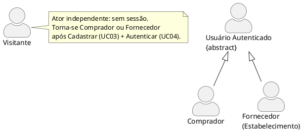
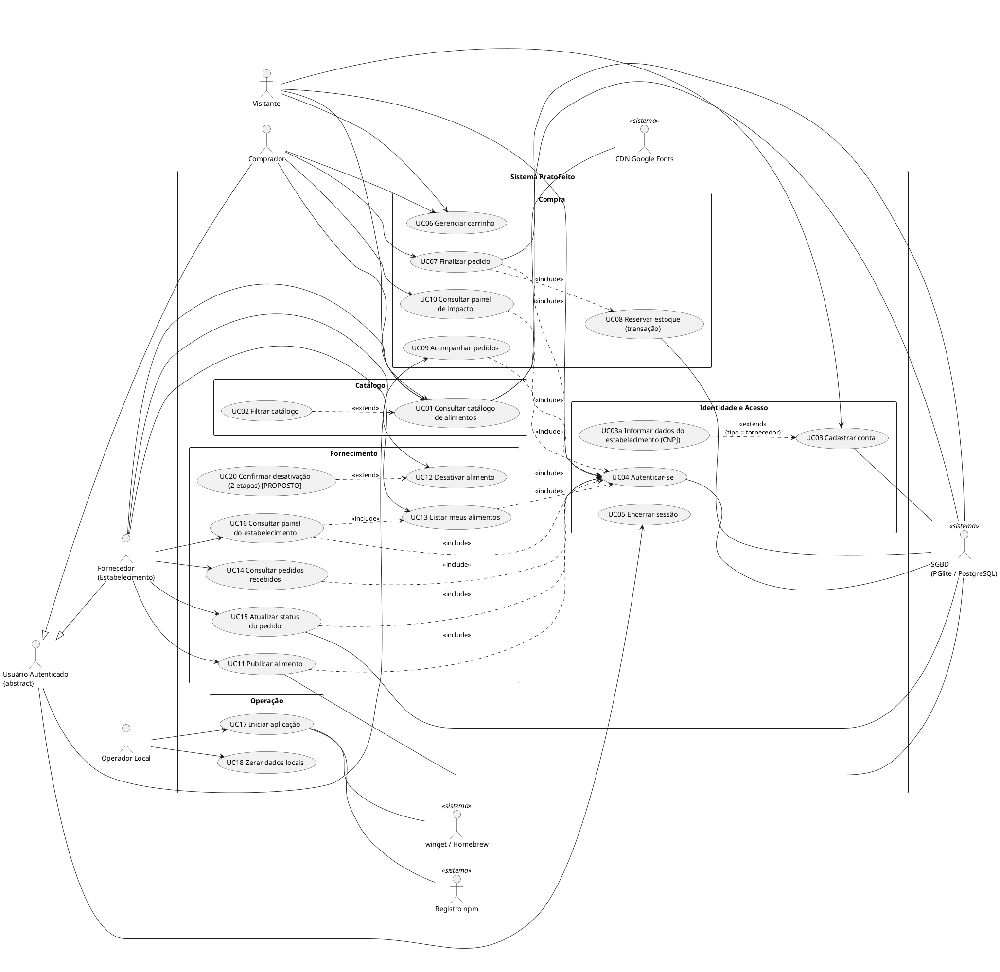
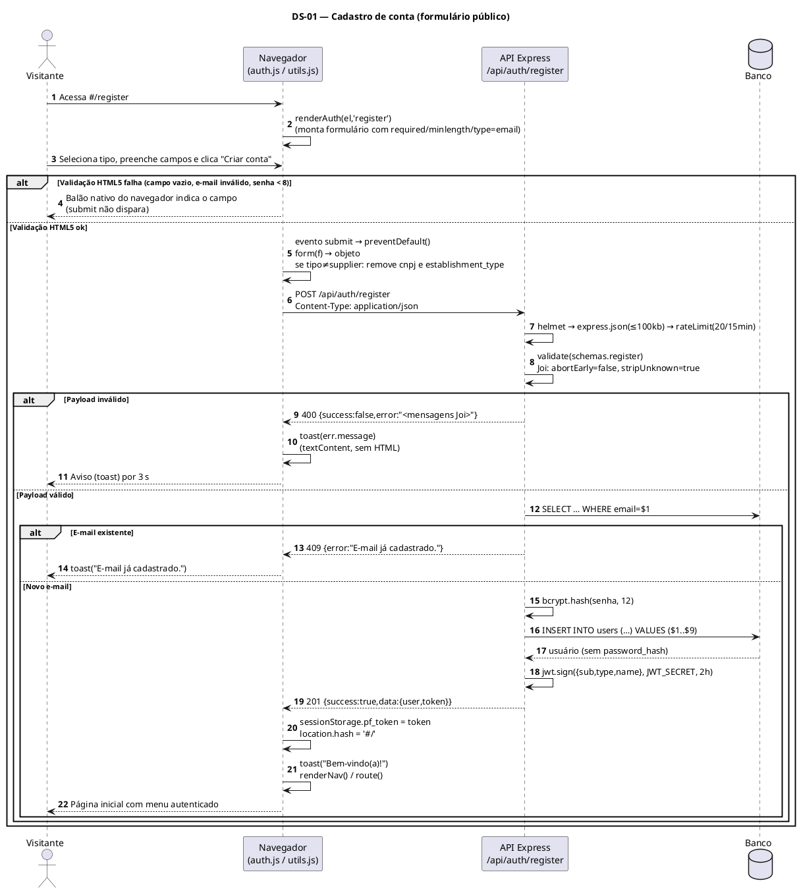
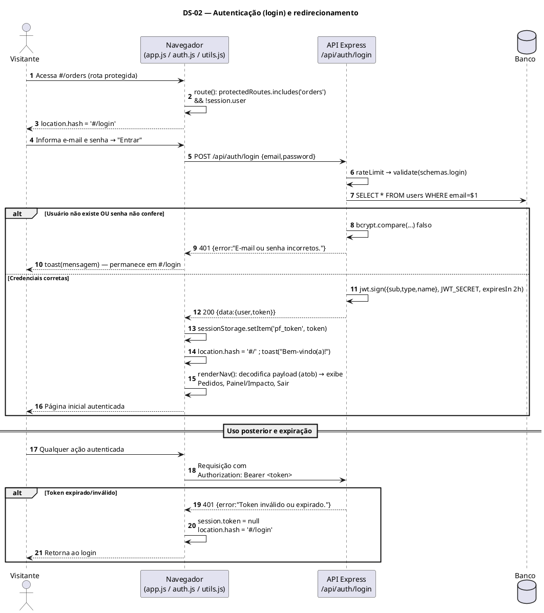
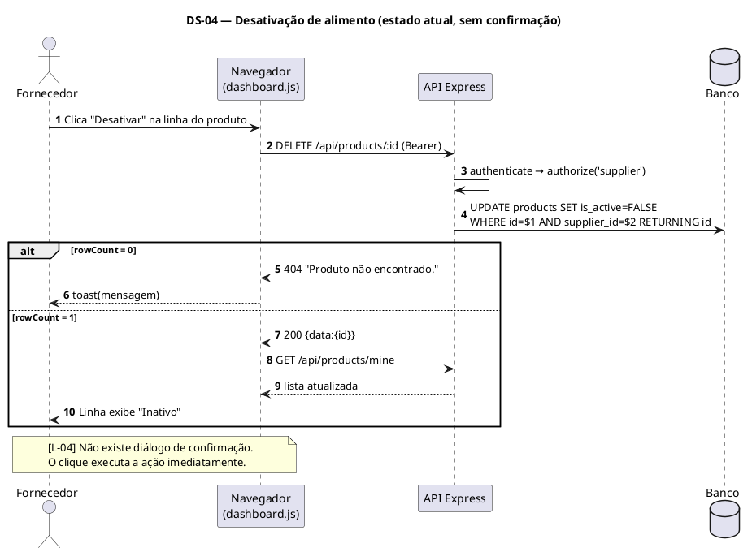
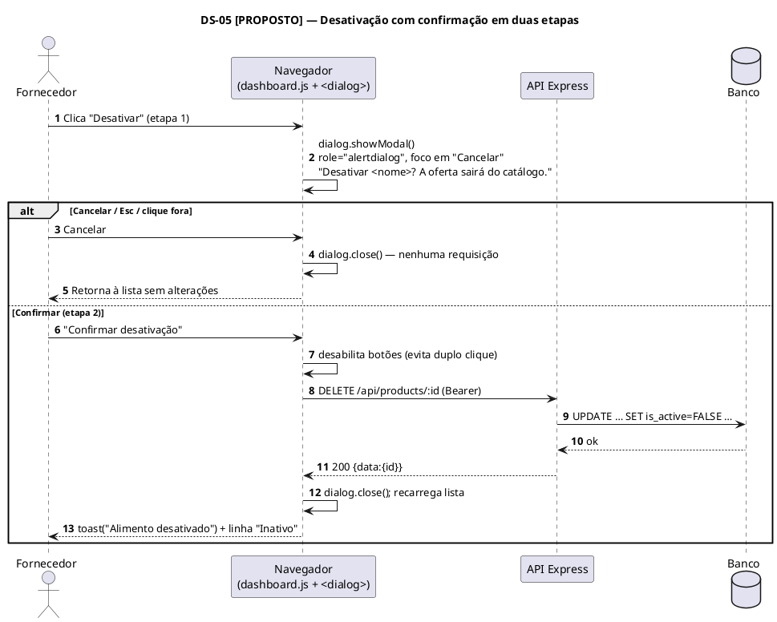
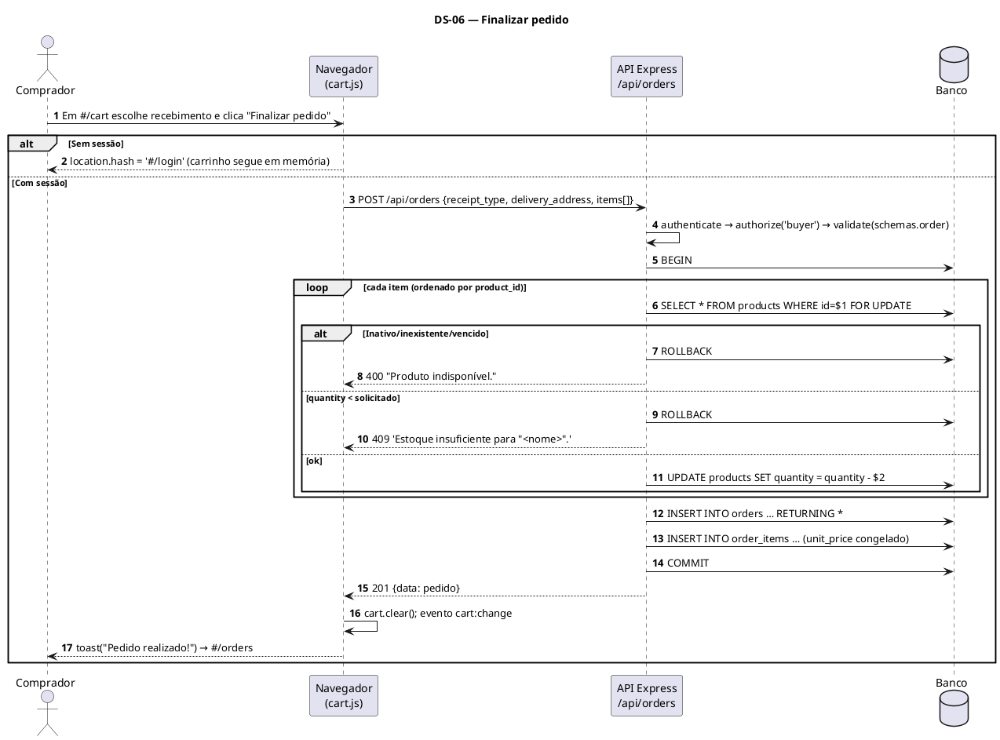

# Documento de Requisitos de Usuário — PratoFeito

| Campo | Valor |
|---|---|
| **Sistema** | PratoFeito — marketplace de alimentos próximos ao vencimento (venda com desconto e doação) |
| **Versão do documento** | 1.0 |
| **Versão do sistema analisado** | `pratofeito-backend` 1.0.0 |
| **Normas de referência** | OMG UML 2.5.1; ISO/IEC/IEEE 29148:2018; ISO/IEC 25010 (FURPS+) |
| **Idioma** | Português Brasileiro (pt-BR) |
| **Documentos relacionados** | `requisitos_de_sistema.md`, `escopo_do_projeto.md` |

> **Nota metodológica.** Este documento foi elaborado por engenharia reversa do código-fonte entregue (`frontend/`, `ecommerce-backend/`, scripts `iniciar.*`). Tudo que está descrito como comportamento do sistema **existe no código**. Quando um requisito esperado em sistemas desse tipo **não está implementado**, ele aparece explicitamente marcado como **[LACUNA Lxx]** ou **[PROPOSTO]**, e nunca como funcionalidade existente. O registro consolidado de lacunas está na Seção 9 de `requisitos_de_sistema.md`.

---

## Sumário

1. Visão geral do produto
2. Atores do sistema
3. Diagrama de Casos de Uso
4. Descrição dos casos de uso
5. Catálogo de Requisitos de Usuário (RU)
6. Histórias de Usuário e Critérios de Aceite (BDD / Gherkin)
7. Diagramas de Sequência (perspectiva do usuário)
8. Glossário e convenções

---

## 1. Visão geral do produto

O PratoFeito conecta **estabelecimentos** (padarias, mercados, restaurantes, hortifrútis) que possuem alimentos próximos da data de validade a **compradores** que desejam adquiri-los com desconto ou recebê-los como doação, reduzindo o desperdício.

**Modos de oferta (`offer_type`)**

| Valor | Significado | Regra de preço |
|---|---|---|
| `discount` | Venda com desconto | `0 ≤ price ≤ original_price` |
| `donation` | Doação | A interface publica com `price = 0` (exibido como "Grátis") |

**Modos de recebimento (`receipt_type`)**: `pickup` (retirar no local) e `delivery` (entrega, exige endereço).

**Interface.** Aplicação de página única (SPA) em HTML5 semântico + CSS3 + JavaScript ES6+ (módulos nativos), com roteamento por *hash* (`#/`, `#/cart`, `#/orders`, `#/dashboard`, `#/login`, `#/register`). Servida pelo próprio servidor Node.js na mesma origem da API (`/api`).

---

## 2. Atores do sistema

Conforme a UML 2.5.1 (§16.3.1 *Actor*), um ator representa um papel externo ao sistema que interage com ele. Os atores abaixo foram derivados do campo `type` do usuário (`buyer` | `supplier`), da ausência de token (visitante) e dos componentes externos que o sistema consome.

### 2.1 Quadro de atores

| ID | Ator | Classificação | Tipo | Descrição | Como é identificado no sistema |
|---|---|---|---|---|---|
| A-01 | **Visitante** | Humano — Primário | Concreto | Pessoa sem sessão. Pode consultar o catálogo, montar carrinho, cadastrar-se e autenticar-se. | Ausência de token JWT em `sessionStorage` (`pf_token`) |
| A-02 | **Usuário Autenticado** | Humano — Primário | **Abstrato** (generalização) | Papel comum a Comprador e Fornecedor: autenticar, sair, ver pedidos e painel. | Token JWT válido |
| A-03 | **Comprador** | Humano — Primário | Concreto (especializa A-02) | Pessoa que adquire alimentos (compra ou doação). | Claim `type = "buyer"` |
| A-04 | **Fornecedor (Estabelecimento)** | Humano — Primário | Concreto (especializa A-02) | Estabelecimento comercial com CNPJ que publica alimentos e atende pedidos. | Claim `type = "supplier"`; `cnpj` obrigatório |
| A-05 | **Operador Local** | Humano — Secundário | Concreto | Pessoa que instala, inicia, encerra e zera os dados da aplicação. Não é um papel dentro da aplicação. | Executa `iniciar.bat` / `iniciar.command` / `iniciar.sh` |
| A-06 | **SGBD (PGlite / PostgreSQL)** | Sistêmico — Secundário | Concreto | Persistência. PGlite (Postgres embutido em `data/pgdata`) por padrão, ou PostgreSQL externo via `DATABASE_URL` / `DB_HOST`. | Módulo `config/db.js` |
| A-07 | **CDN Google Fonts** | Sistêmico — Secundário | Concreto | Fornece a fonte *Bricolage Grotesque* (`fonts.googleapis.com`, `fonts.gstatic.com`). | `<link>` em `index.html` |
| A-08 | **Registro npm** | Sistêmico — Secundário | Concreto | Fornece dependências na primeira execução (`npm install`). | `iniciar.*` |
| A-09 | **Gerenciador de pacotes do SO** | Sistêmico — Secundário | Concreto | `winget` (Windows) ou Homebrew (macOS) para instalar o Node.js quando ausente. | `iniciar.bat`, `iniciar.sh` |

### 2.2 Hierarquia de generalização



### 2.3 Permissões por papel (matriz ator × capacidade)

| Capacidade | Visitante | Comprador | Fornecedor |
|---|:-:|:-:|:-:|
| Consultar/filtrar catálogo | ✔ | ✔ | ✔ |
| Montar carrinho (item de menu "Carrinho") | ✔ | ✔ | ✘ (oculto no menu) |
| Cadastrar-se / Entrar | ✔ | — | — |
| Finalizar pedido | ✘ (redireciona ao login) | ✔ | ✘ (HTTP 403) |
| Ver "Pedidos" | ✘ (redireciona) | ✔ (próprios) | ✔ (recebidos) |
| Painel | ✘ (redireciona) | ✔ "Impacto" | ✔ "Painel do estabelecimento" |
| Publicar / listar / desativar alimentos | ✘ | ✘ (HTTP 403) | ✔ |
| Alterar status de pedido | ✘ | ✘ (HTTP 403) | ✔ |

---

## 3. Diagrama de Casos de Uso

Fronteira do sistema (*System Boundary*) representada pelo retângulo **Sistema PratoFeito**. Relações `<<include>>` indicam comportamento obrigatório reutilizado; `<<extend>>` indica comportamento opcional condicionado.



**Justificativa das relações**

| Relação | Justificativa |
|---|---|
| `UC02 <<extend>> UC01` | Filtros são opcionais; o catálogo é exibido sem eles (`GET /api/products`). |
| `UC03a <<extend>> UC03` | Os campos CNPJ e tipo de estabelecimento só surgem quando `type = supplier`. |
| `UC07 <<include>> UC04` | Finalizar pedido exige sessão; sem ela o fluxo redireciona a `#/login`. |
| `UC07 <<include>> UC08` | A baixa de estoque é parte obrigatória e atômica do checkout (transação com `SELECT … FOR UPDATE`). |
| `UC09/10/11/12/13/14/15/16 <<include>> UC04` | Todas as rotas protegidas exigem token válido (`authenticate`). |
| `UC16 <<include>> UC13` | O painel do fornecedor embute a listagem de produtos próprios. |
| `UC20 <<extend>> UC12` | **[PROPOSTO]** A confirmação em duas etapas não existe no código atual (**L-04**). |

**APIs sem tela correspondente (fora do diagrama por não terem interface):** `GET /api/users/me`, `GET /api/products/:id`, `PUT /api/products/:id` (**L-12**).

---

## 4. Descrição resumida dos casos de uso

| ID | Nome | Ator principal | Objetivo |
|---|---|---|---|
| UC01 | Consultar catálogo de alimentos | Visitante, Comprador, Fornecedor | Ver ofertas ativas, com estoque e dentro da validade, ordenadas pela validade mais próxima (máx. 100). |
| UC02 | Filtrar catálogo | Visitante, Comprador, Fornecedor | Refinar por texto (`q`), categoria e tipo de oferta. |
| UC03 | Cadastrar conta | Visitante | Criar conta de comprador ou de estabelecimento. |
| UC03a | Informar dados do estabelecimento | Visitante | Informar CNPJ e tipo de estabelecimento. |
| UC04 | Autenticar-se | Visitante | Obter token JWT e iniciar sessão. |
| UC05 | Encerrar sessão | Usuário Autenticado | Descartar o token no navegador. |
| UC06 | Gerenciar carrinho | Visitante, Comprador | Adicionar/remover itens (memória da aba). |
| UC07 | Finalizar pedido | Comprador | Registrar pedido com itens e forma de recebimento. |
| UC08 | Reservar estoque | (interno) | Bloquear linhas, validar disponibilidade e decrementar estoque atomicamente. |
| UC09 | Acompanhar pedidos | Comprador / Fornecedor | Listar pedidos próprios (comprador) ou recebidos (fornecedor). |
| UC10 | Consultar painel de impacto | Comprador | Ver itens salvos, pedidos concluídos e valor gasto. |
| UC11 | Publicar alimento | Fornecedor | Cadastrar oferta (desconto ou doação). |
| UC12 | Desativar alimento | Fornecedor | Remoção lógica (`is_active = FALSE`). |
| UC13 | Listar meus alimentos | Fornecedor | Ver todos os produtos próprios, ativos e inativos. |
| UC14 | Consultar pedidos recebidos | Fornecedor | Ver pedidos que contêm itens do estabelecimento. |
| UC15 | Atualizar status do pedido | Fornecedor | Mover o pedido pelo ciclo de atendimento. |
| UC16 | Consultar painel do estabelecimento | Fornecedor | Ver indicadores, formulário de publicação e lista de produtos. |
| UC17 | Iniciar aplicação | Operador Local | Subir servidor e banco com um clique. |
| UC18 | Zerar dados locais | Operador Local | Apagar `ecommerce-backend/data`. |
| UC20 | Confirmar desativação (2 etapas) | Fornecedor | **[PROPOSTO]** Evitar desativação acidental. |

---

## 5. Catálogo de Requisitos de Usuário (RU)

**Legenda MoSCoW:** **M** = *Must have* · **S** = *Should have* · **C** = *Could have* · **W** = *Won't have (nesta versão)*.
**Situação:** ✔ Implementado · ◐ Parcial · ✘ Não implementado.

### 5.1 Índice dos RUs

| ID | Título | Caso de Uso | Ator principal | MoSCoW | Situação |
|---|---|---|---|:-:|:-:|
| RU-01 | Consultar catálogo de alimentos | UC01 | Visitante | M | ✔ |
| RU-02 | Filtrar catálogo | UC02 | Visitante | S | ✔ |
| RU-03 | Cadastrar conta de comprador | UC03 | Visitante | M | ✔ |
| RU-04 | Cadastrar conta de estabelecimento | UC03 + UC03a | Visitante | M | ✔ |
| RU-05 | Autenticar-se | UC04 | Visitante | M | ✔ |
| RU-06 | Encerrar sessão | UC05 | Usuário Autenticado | M | ✔ |
| RU-07 | Gerenciar carrinho | UC06 | Comprador | M | ◐ (L-11) |
| RU-08 | Finalizar pedido | UC07 + UC08 | Comprador | M | ✔ |
| RU-09 | Acompanhar pedidos | UC09 | Comprador / Fornecedor | M | ✔ |
| RU-10 | Consultar painel de impacto | UC10 | Comprador | C | ✔ |
| RU-11 | Publicar alimento | UC11 | Fornecedor | M | ✔ |
| RU-12 | Listar meus alimentos | UC13 | Fornecedor | M | ✔ |
| RU-13 | Desativar alimento | UC12 | Fornecedor | M | ✔ |
| RU-14 | Consultar pedidos recebidos | UC14 | Fornecedor | M | ✔ |
| RU-15 | Atualizar status do pedido | UC15 | Fornecedor | M | ◐ (L-01, L-02) |
| RU-16 | Consultar painel do estabelecimento | UC16 | Fornecedor | S | ✔ |
| RU-17 | Iniciar a aplicação com um clique | UC17 | Operador Local | M | ✔ |
| RU-18 | Zerar dados locais | UC18 | Operador Local | C | ✔ |
| RU-19 | Confirmar desativação em duas etapas | UC20 | Fornecedor | S | ✘ (L-04) |
| RU-20 | Editar alimento pela interface | — (API `PUT`) | Fornecedor | W | ✘ (L-12) |

---

### RU-01 — Consultar catálogo de alimentos
| Campo | Conteúdo |
|---|---|
| **Caso de Uso** | UC01 |
| **Ator principal** | Visitante (também Comprador e Fornecedor) |
| **Prioridade** | Must |
| **Pré-condições** | Servidor em execução; navegador com JavaScript habilitado. |
| **Fluxo operacional** | 1. O ator acessa `/` (rota `#/`). 2. O sistema renderiza título, formulário de filtros e contêiner de lista. 3. O sistema consulta `GET /api/products`. 4. O sistema exibe um cartão por produto com: etiqueta "Doação" (quando aplicável), nome, estabelecimento, data de validade, preço (ou "Grátis") e preço original riscado, quantidade + unidade, horário de retirada (ou "a combinar") e botão "Adicionar ao carrinho". |
| **Fluxo alternativo A1** | Nenhum resultado: exibe "Nenhum alimento encontrado. Tente outro filtro." |
| **Fluxo de exceção E1** | Falha de rede/servidor: a mensagem de erro é exibida no lugar da lista. |
| **Pós-condições** | Lista exibida. Somente produtos com `is_active = TRUE`, `quantity > 0` e `expiry_date ≥ hoje`, ordenados por validade ascendente, máx. 100. |

### RU-02 — Filtrar catálogo
| Campo | Conteúdo |
|---|---|
| **Caso de Uso** | UC02 (extend de UC01) |
| **Ator principal** | Visitante |
| **Prioridade** | Should |
| **Pré-condições** | Catálogo exibido (RU-01). |
| **Fluxo operacional** | 1. O ator preenche "Buscar alimento" (`q`), "Categoria" (`category`) e/ou "Tipo de oferta" (`offer_type`). 2. Aciona **Filtrar**. 3. O sistema monta a *query string* apenas com campos preenchidos. 4. O sistema consulta `GET /api/products?...`. 5. O sistema substitui a lista. |
| **Regras** | `q` filtra por nome, sem diferenciar maiúsculas/minúsculas (`ILIKE`); `category` é igualdade exata e diferencia maiúsculas/minúsculas; `offer_type` ∈ {`discount`, `donation`}. |
| **Pós-condições** | Lista refletindo os filtros combinados com E. |

### RU-03 — Cadastrar conta de comprador
| Campo | Conteúdo |
|---|---|
| **Caso de Uso** | UC03 |
| **Ator principal** | Visitante |
| **Prioridade** | Must |
| **Pré-condições** | Sem sessão ativa; e-mail não cadastrado. |
| **Fluxo operacional** | 1. O ator acessa `#/register`. 2. Mantém "Quero comprar". 3. Preenche Nome (≥ 2), E-mail, Senha (≥ 8), Cidade e Endereço (opcionais). 4. Aciona **Criar conta**. 5. O navegador valida `required`, `minlength` e `type=email` (HTML5). 6. O front envia `POST /api/auth/register`. 7. O servidor valida (Joi), gera hash bcrypt e persiste. 8. O servidor devolve `{ user, token }`; o front guarda o token, exibe o toast "Bem-vindo(a)!" e redireciona para `#/`. |
| **Fluxo de exceção E1** | E-mail já existente → HTTP 409 "E-mail já cadastrado." (toast). |
| **Fluxo de exceção E2** | Dados inválidos → HTTP 400 com mensagens Joi concatenadas (hoje em inglês — **L-19**). |
| **Fluxo de exceção E3** | Mais de 20 requisições a `/api/auth` em 15 min por IP → HTTP 429. |
| **Pós-condições** | Usuário `buyer` criado; senha armazenada apenas como hash; sessão iniciada (cadastro já autentica). |

### RU-04 — Cadastrar conta de estabelecimento
| Campo | Conteúdo |
|---|---|
| **Caso de Uso** | UC03 + UC03a (extend) |
| **Ator principal** | Visitante |
| **Prioridade** | Must |
| **Pré-condições** | Idênticas a RU-03. |
| **Fluxo operacional** | 1–2. Como RU-03, mas seleciona "Tenho um estabelecimento". 3. Os campos **CNPJ** e **Tipo de estabelecimento** tornam-se visíveis. 4. O ator informa CNPJ no formato `00.000.000/0000-00` (aceita dígitos, `.`, `/`, `-`; 14 a 18 caracteres). 5–8. Como RU-03. |
| **Regra de negócio** | CNPJ é obrigatório para `supplier` (Joi **e** restrição `CHECK` no banco). Para `buyer`, o front remove `cnpj` e `establishment_type` e o back os descarta. |
| **Observação** | O campo CNPJ não possui `required` em HTML5; a ausência é detectada somente no servidor (HTTP 400). A validade dos dígitos verificadores **não** é conferida (**L-16**). |
| **Pós-condições** | Usuário `supplier` criado com CNPJ; sessão iniciada. |

### RU-05 — Autenticar-se
| Campo | Conteúdo |
|---|---|
| **Caso de Uso** | UC04 |
| **Ator principal** | Visitante |
| **Prioridade** | Must |
| **Pré-condições** | Conta existente. |
| **Fluxo operacional** | 1. O ator acessa `#/login` (ou é redirecionado de rota protegida). 2. Informa e-mail e senha. 3. Aciona **Entrar**. 4. O front envia `POST /api/auth/login`. 5. O servidor busca o usuário, compara a senha com bcrypt e assina um JWT (`sub`, `type`, `name`; expira em 2 h por padrão). 6. O front armazena o token em `sessionStorage` (`pf_token`), exibe "Bem-vindo(a)!" e redireciona a `#/`. 7. O menu passa a exibir "Pedidos", "Painel"/"Impacto" e "Sair". |
| **Fluxo de exceção E1** | Credenciais incorretas → HTTP 401 "E-mail ou senha incorretos." (mensagem única para e-mail inexistente e senha errada). |
| **Fluxo de exceção E2** | Token expirado durante o uso → a próxima chamada recebe HTTP 401; o front limpa o token e redireciona a `#/login`. |
| **Pós-condições** | Token válido na aba atual; a sessão **não** persiste ao fechar a aba (`sessionStorage`). |

### RU-06 — Encerrar sessão
| Campo | Conteúdo |
|---|---|
| **Caso de Uso** | UC05 |
| **Ator principal** | Usuário Autenticado |
| **Prioridade** | Must |
| **Pré-condições** | Sessão ativa. |
| **Fluxo operacional** | 1. O ator aciona **Sair**. 2. O front remove `pf_token` do `sessionStorage`. 3. Redireciona a `#/`. 4. O menu volta ao estado de visitante. |
| **Observação** | O encerramento é apenas local: o JWT continua tecnicamente válido até expirar (não há lista de revogação — **L-09**). |
| **Pós-condições** | Sem token no navegador. |

### RU-07 — Gerenciar carrinho
| Campo | Conteúdo |
|---|---|
| **Caso de Uso** | UC06 |
| **Ator principal** | Comprador (e Visitante) |
| **Prioridade** | Must |
| **Pré-condições** | Ao menos um produto exibido no catálogo. |
| **Fluxo operacional** | 1. O ator aciona **Adicionar ao carrinho** em um cartão. 2. O sistema inclui o item com quantidade 1 ou incrementa +1, limitado ao estoque exibido. 3. O contador "Carrinho (n)" no menu é atualizado e o toast "Adicionado ao carrinho" é exibido. 4. Em `#/cart`, o ator vê itens, quantidade × preço e total, e pode **Remover** cada item. |
| **Fluxo alternativo A1** | Carrinho vazio: exibe "Carrinho vazio" com link ao catálogo. |
| **Limitação** | O carrinho existe apenas em memória JavaScript; **recarregar a página (F5) o esvazia** (**L-11**). Não há tela para alterar a quantidade diretamente; só adicionar (+1) ou remover o item inteiro. |
| **Pós-condições** | Estado do carrinho consistente com o contador do menu. |

### RU-08 — Finalizar pedido
| Campo | Conteúdo |
|---|---|
| **Caso de Uso** | UC07 (include UC04, include UC08) |
| **Ator principal** | Comprador |
| **Prioridade** | Must |
| **Pré-condições** | Carrinho não vazio; sessão de **comprador**. |
| **Fluxo operacional** | 1. Em `#/cart`, o ator escolhe "Retirar no local" ou "Entrega". 2. Se Entrega, informa o endereço. 3. Aciona **Finalizar pedido**. 4. Sem sessão → redireciona a `#/login` (carrinho preservado em memória). 5. O front envia `POST /api/orders` com `receipt_type`, `delivery_address` e `items[{product_id, quantity}]`. 6. O servidor abre transação, trava cada produto (`FOR UPDATE`), valida disponibilidade e estoque, decrementa estoque, calcula o total, grava `orders` e `order_items` (com `unit_price` congelado) e confirma (`COMMIT`). 7. O front esvazia o carrinho, exibe "Pedido realizado!" e redireciona a `#/orders`. |
| **Fluxo de exceção E1** | Produto inativo, inexistente ou vencido → HTTP 400 "Produto indisponível." (rollback total). |
| **Fluxo de exceção E2** | Quantidade acima do estoque → HTTP 409 `Estoque insuficiente para "<nome>".` (rollback total). |
| **Fluxo de exceção E3** | Entrega sem endereço → HTTP 400. |
| **Fluxo de exceção E4** | Usuário fornecedor tentando comprar → HTTP 403 "Acesso negado." |
| **Pós-condições** | Pedido criado com status `pending` e número sequencial (iniciando em 1000); estoque decrementado; operação atômica (tudo ou nada). Pagamento **não** é processado pelo sistema. |

### RU-09 — Acompanhar pedidos
| Campo | Conteúdo |
|---|---|
| **Caso de Uso** | UC09 / UC14 |
| **Ator principal** | Comprador (próprios) / Fornecedor (recebidos) |
| **Prioridade** | Must |
| **Pré-condições** | Sessão ativa. |
| **Fluxo operacional** | 1. O ator acessa `#/orders`. 2. O sistema consulta `GET /api/orders` (o escopo depende do papel no token). 3. Exibe tabela: nº do pedido (`#1000`) e data, itens (`2× Nome`), total e status. 4. Para o comprador o status é texto; para o fornecedor é um seletor editável (RU-15). |
| **Fluxo alternativo A1** | Sem pedidos: "Nenhum pedido ainda." |
| **Fluxo de exceção E1** | Sem sessão: redireciona a `#/login`. |
| **Pós-condições** | Lista ordenada do mais recente para o mais antigo. |

### RU-10 — Consultar painel de impacto
| Campo | Conteúdo |
|---|---|
| **Caso de Uso** | UC10 |
| **Ator principal** | Comprador |
| **Prioridade** | Could |
| **Pré-condições** | Sessão de comprador. |
| **Fluxo operacional** | 1. O ator acessa `#/dashboard` ("Impacto"). 2. O sistema obtém `GET /api/orders`, filtra os de status `completed` e calcula: itens salvos do lixo (soma das quantidades), pedidos concluídos e valor gasto. |
| **Observação** | A soma de quantidades mistura unidades (un, kg) (**L-20**). |
| **Pós-condições** | Três indicadores exibidos. |

### RU-11 — Publicar alimento
| Campo | Conteúdo |
|---|---|
| **Caso de Uso** | UC11 |
| **Ator principal** | Fornecedor |
| **Prioridade** | Must |
| **Pré-condições** | Sessão de fornecedor. |
| **Fluxo operacional** | 1. Em `#/dashboard`, o ator preenche: Nome, Categoria, Quantidade (≥ 0), Unidade (padrão `un`), Validade, Preço original, Preço com desconto, Tipo (Desconto/Doação), Horário de retirada. 2. Aciona **Publicar**. 3. Se Tipo = Doação, o front força `price = 0`. 4. O front envia `POST /api/products`. 5. O servidor valida (inclusive `price ≤ original_price`) e persiste com `supplier_id` do token. 6. O front exibe "Produto publicado" e recarrega a lista. |
| **Fluxo de exceção E1** | Preço com desconto maior que o original → HTTP 400. |
| **Fluxo de exceção E2** | Papel diferente de fornecedor → HTTP 403. |
| **Pós-condições** | Produto ativo, visível no catálogo enquanto houver estoque e validade. |

### RU-12 — Listar meus alimentos
| Campo | Conteúdo |
|---|---|
| **Caso de Uso** | UC13 |
| **Ator principal** | Fornecedor |
| **Prioridade** | Must |
| **Pré-condições** | Sessão de fornecedor. |
| **Fluxo operacional** | 1. O painel consulta `GET /api/products/mine`. 2. Exibe nome, quantidade + unidade, preço (ou "Inativo") e botão **Desativar** para os ativos. |
| **Pós-condições** | Lista de todos os produtos do fornecedor, do mais recente ao mais antigo. |

### RU-13 — Desativar alimento
| Campo | Conteúdo |
|---|---|
| **Caso de Uso** | UC12 |
| **Ator principal** | Fornecedor |
| **Prioridade** | Must |
| **Pré-condições** | Produto próprio e ativo. |
| **Fluxo operacional** | 1. O ator aciona **Desativar** na linha do produto. 2. O front envia `DELETE /api/products/:id`. 3. O servidor executa `UPDATE … SET is_active = FALSE` restrito ao `supplier_id` do token. 4. O front recarrega a lista (o produto aparece como "Inativo"). |
| **Fluxo de exceção E1** | Produto inexistente ou de outro fornecedor → HTTP 404 "Produto não encontrado." |
| **Regra** | A exclusão é **lógica** (preserva histórico de pedidos). Não há reativação pela interface. |
| **Observação** | **Não há diálogo de confirmação**: o clique desativa imediatamente (**L-04**; ver RU-19). |
| **Pós-condições** | `is_active = FALSE`; produto some do catálogo público. |

### RU-14 — Consultar pedidos recebidos
| Campo | Conteúdo |
|---|---|
| **Caso de Uso** | UC14 |
| **Ator principal** | Fornecedor |
| **Prioridade** | Must |
| **Pré-condições** | Sessão de fornecedor. |
| **Fluxo operacional** | Idêntico a RU-09, mas o escopo contém apenas pedidos que possuem ao menos um item de produto do fornecedor; os itens exibidos são apenas os dele. |
| **Observação** | O **total** exibido é o do pedido inteiro, mesmo em pedidos com itens de vários fornecedores (**L-10**). |
| **Pós-condições** | Lista de pedidos recebidos. |

### RU-15 — Atualizar status do pedido
| Campo | Conteúdo |
|---|---|
| **Caso de Uso** | UC15 |
| **Ator principal** | Fornecedor |
| **Prioridade** | Must |
| **Pré-condições** | Pedido contendo item do fornecedor. |
| **Fluxo operacional** | 1. Em `#/orders`, o ator altera o seletor de status de um pedido. 2. O front envia `PATCH /api/orders/:id/status` com `{ status }`. 3. O servidor valida o valor (∈ `confirmed`, `ready`, `completed`, `cancelled`) e atualiza se o fornecedor possuir item no pedido. 4. O front exibe o toast "Status atualizado". |
| **Ciclo pretendido** | `pending → confirmed → ready → completed`; `cancelled` a partir de qualquer estado não terminal. |
| **Fluxo de exceção E1** | Pedido inexistente ou sem item do fornecedor → HTTP 404 "Pedido não encontrado." |
| **Fluxo de exceção E2** | Valor de status inválido (inclusive `pending`) → HTTP 400. |
| **Lacunas** | O servidor **não impõe a ordem das transições** (**L-01**), e o cancelamento **não devolve o estoque** (**L-02**). Se a chamada falhar, o seletor permanece no valor novo até o recarregamento. |
| **Pós-condições** | `orders.status` atualizado. |

### RU-16 — Consultar painel do estabelecimento
| Campo | Conteúdo |
|---|---|
| **Caso de Uso** | UC16 |
| **Ator principal** | Fornecedor |
| **Prioridade** | Should |
| **Fluxo operacional** | Em `#/dashboard`, o sistema mostra: itens vendidos/doados em pedidos concluídos, quantidade de pedidos concluídos, valor faturado, formulário de publicação (RU-11) e lista de produtos (RU-12). |
| **Pós-condições** | Indicadores e gestão de oferta numa única tela. |

### RU-17 — Iniciar a aplicação com um clique
| Campo | Conteúdo |
|---|---|
| **Caso de Uso** | UC17 |
| **Ator principal** | Operador Local |
| **Prioridade** | Must |
| **Pré-condições** | Pasta descompactada; internet na primeira execução. |
| **Fluxo operacional** | 1. O operador executa `iniciar.bat` (Windows), `iniciar.command` (macOS) ou `iniciar.sh` (Linux). 2. O script verifica o Node.js; se ausente, tenta instalar (`winget`/Homebrew) ou abre a página de download. 3. Se `node_modules` não existir, executa `npm install`. 4. Inicia `node server.js` com `OPEN_BROWSER=1`. 5. O servidor cria o banco embutido, aplica o esquema, popula dados de demonstração (fora de produção), escolhe porta livre a partir de 3000 e abre o navegador. |
| **Fluxo alternativo A1** | Já existe instância do PratoFeito em execução (verificada via `/api/health`): apenas abre o navegador nela. |
| **Fluxo alternativo A2** | Porta ocupada por outro programa: tenta até 10 portas seguintes. |
| **Pós-condições** | Aplicação acessível em `http://localhost:<porta>`. Contas de demonstração: `fornecedor@demo.com` e `comprador@demo.com` (senha `demo12345`). |

### RU-18 — Zerar dados locais
| Campo | Conteúdo |
|---|---|
| **Caso de Uso** | UC18 |
| **Ator principal** | Operador Local |
| **Prioridade** | Could |
| **Fluxo operacional** | 1. Encerrar o servidor (Ctrl+C). 2. Apagar a pasta `ecommerce-backend/data`. 3. Iniciar novamente (RU-17). |
| **Pós-condições** | Banco recriado do zero; **novo** `jwt.secret` gerado (tokens antigos tornam-se inválidos). |

### RU-19 — Confirmar desativação em duas etapas  `[PROPOSTO — NÃO IMPLEMENTADO]`
| Campo | Conteúdo |
|---|---|
| **Caso de Uso** | UC20 (extend de UC12) |
| **Ator principal** | Fornecedor |
| **Prioridade** | Should |
| **Pré-condições** | Produto ativo. |
| **Fluxo proposto** | 1. O ator aciona **Desativar**. 2. O sistema abre diálogo modal (`<dialog>`/`role="alertdialog"`) com o nome do produto e o aviso de que a oferta sairá do catálogo. 3. O ator escolhe **Confirmar desativação** ou **Cancelar** (Esc também cancela). 4. Só na confirmação é disparado `DELETE /api/products/:id`. |
| **Justificativa** | Ação destrutiva de um clique, sem reativação pela UI (**L-04**). |

### RU-20 — Editar alimento pela interface  `[W — fora desta versão]`
A API `PUT /api/products/:id` existe e valida o mesmo esquema da publicação, mas **não há tela** que a utilize (**L-12**). Registrado como *Won't have* para esta versão.

---

## 6. Histórias de Usuário e Critérios de Aceite (BDD / Gherkin)

Formato das histórias: *"Como [ator], quero [objetivo], para [benefício]"*. Os cenários seguem Gherkin em português (`# language: pt`).

### HU-01 (RU-01) — Consultar catálogo
**Como** visitante, **quero** ver alimentos disponíveis com validade, preço e local de retirada, **para** decidir o que comprar ou retirar.

```gherkin
# language: pt
Funcionalidade: Consultar catálogo de alimentos

  Cenário: Exibir ofertas ativas ordenadas por validade
    Dado que existem produtos ativos, com estoque e validade futura
    Quando o visitante acessa a página inicial
    Então o sistema lista os produtos ordenados da validade mais próxima para a mais distante
    E cada cartão mostra nome, estabelecimento, validade, preço, quantidade e horário de retirada

  Cenário: Ocultar produtos indisponíveis
    Dado que existem produtos inativos, esgotados ou vencidos
    Quando o visitante acessa a página inicial
    Então esses produtos não aparecem na lista

  Cenário: Doação exibida como gratuita
    Dado que um produto tem tipo de oferta "donation"
    Quando o visitante visualiza o cartão
    Então o cartão exibe a etiqueta "Doação" e o preço "Grátis"

  Cenário: Catálogo vazio
    Dado que não há nenhum produto disponível
    Quando o visitante acessa a página inicial
    Então o sistema exibe "Nenhum alimento encontrado. Tente outro filtro."
```

### HU-02 (RU-02) — Filtrar catálogo
**Como** visitante, **quero** buscar por nome, categoria e tipo de oferta, **para** achar rapidamente o que me interessa.

```gherkin
# language: pt
Funcionalidade: Filtrar catálogo

  Cenário: Buscar por parte do nome sem diferenciar maiúsculas
    Dado que existe o produto "Pão francês (lote do dia)"
    Quando o visitante digita "PÃO" em "Buscar alimento" e aciona "Filtrar"
    Então o produto aparece na lista

  Cenário: Mostrar apenas doações
    Dado que existem ofertas com desconto e doações
    Quando o visitante seleciona "Doações" e aciona "Filtrar"
    Então somente produtos com tipo "donation" são exibidos

  Cenário: Combinar filtros
    Quando o visitante informa a categoria "Padaria" e seleciona "Com desconto"
    Então somente produtos da categoria "Padaria" com desconto são exibidos
```

### HU-03 (RU-03) — Cadastrar conta de comprador
**Como** visitante, **quero** criar uma conta de comprador, **para** fazer pedidos.

```gherkin
# language: pt
Funcionalidade: Cadastro de comprador

  Cenário: Cadastro com sucesso
    Dado que o visitante está em "Criar sua conta" com "Quero comprar" selecionado
    Quando preenche nome "Maria", e-mail inédito e senha de 8 ou mais caracteres e aciona "Criar conta"
    Então o sistema cria a conta, inicia a sessão e exibe o aviso "Bem-vindo(a)!"
    E redireciona para a página inicial

  Cenário: Validação HTML5 impede envio incompleto
    Quando o visitante aciona "Criar conta" com senha de 5 caracteres
    Então o navegador bloqueia o envio e indica o campo inválido
    E nenhuma requisição é enviada ao servidor

  Cenário: E-mail já cadastrado
    Dado que "comprador@demo.com" já possui conta
    Quando o visitante tenta se cadastrar com esse e-mail
    Então o sistema exibe "E-mail já cadastrado."

  Cenário: Senha armazenada com segurança
    Quando a conta é criada
    Então a senha não é gravada em texto puro
    E apenas seu hash bcrypt (custo 12) é persistido
```

### HU-04 (RU-04) — Cadastrar estabelecimento
**Como** dono de estabelecimento, **quero** criar uma conta de fornecedor com CNPJ, **para** publicar alimentos.

```gherkin
# language: pt
Funcionalidade: Cadastro de fornecedor

  Cenário: Campos de estabelecimento aparecem conforme o tipo
    Dado que o visitante está na tela de cadastro
    Quando seleciona "Tenho um estabelecimento"
    Então os campos "CNPJ" e "Tipo de estabelecimento" ficam visíveis

  Cenário: Cadastro de fornecedor com CNPJ
    Quando o visitante informa CNPJ "12.345.678/0001-90" e demais dados válidos
    Então a conta de fornecedor é criada e a sessão iniciada

  Cenário: CNPJ ausente
    Quando o visitante seleciona "Tenho um estabelecimento" e deixa o CNPJ em branco
    Então o servidor rejeita o cadastro com status 400

  Cenário: Dados de estabelecimento ignorados para comprador
    Quando o visitante escolhe "Quero comprar"
    Então CNPJ e tipo de estabelecimento não são enviados nem persistidos
```

### HU-05 (RU-05) — Autenticar-se
**Como** usuário cadastrado, **quero** entrar com e-mail e senha, **para** acessar minhas funções.

```gherkin
# language: pt
Funcionalidade: Autenticação

  Cenário: Login válido
    Dado que existe a conta "fornecedor@demo.com"
    Quando o usuário informa e-mail e senha corretos e aciona "Entrar"
    Então o sistema armazena o token na sessão do navegador
    E o menu exibe "Pedidos", "Painel" e "Sair"

  Cenário: Credenciais inválidas
    Quando o usuário informa senha incorreta
    Então o sistema exibe "E-mail ou senha incorretos."
    E nenhum token é armazenado

  Cenário: Rota protegida sem sessão
    Dado que o visitante não está autenticado
    Quando acessa "#/orders"
    Então é redirecionado para "#/login"

  Cenário: Token expirado
    Dado que o token do usuário expirou
    Quando o usuário realiza qualquer ação que chama a API
    Então o sistema descarta o token e redireciona para "#/login"

  Cenário: Limite de tentativas
    Dado que um mesmo IP fez 20 requisições a "/api/auth" em 15 minutos
    Quando faz a 21ª requisição
    Então o sistema responde 429 com "Muitas tentativas. Tente novamente em 15 minutos."
```

### HU-06 (RU-06) — Encerrar sessão
**Como** usuário autenticado, **quero** sair da minha conta, **para** proteger meus dados em computador compartilhado.

```gherkin
# language: pt
Funcionalidade: Encerrar sessão

  Cenário: Sair da conta
    Dado que o usuário está autenticado
    Quando aciona "Sair"
    Então o token é removido do navegador
    E o menu volta a exibir "Entrar" e "Criar conta"
```

### HU-07 (RU-07) — Gerenciar carrinho
**Como** comprador, **quero** montar um carrinho, **para** pedir vários itens de uma vez.

```gherkin
# language: pt
Funcionalidade: Carrinho

  Cenário: Adicionar item
    Quando o comprador aciona "Adicionar ao carrinho" em um produto
    Então o menu mostra "Carrinho (1)" e o aviso "Adicionado ao carrinho"

  Cenário: Limitar à quantidade em estoque
    Dado que o produto tem 2 unidades em estoque
    Quando o comprador adiciona o produto 3 vezes
    Então a quantidade no carrinho permanece 2

  Cenário: Remover item
    Dado que o carrinho contém um produto
    Quando o comprador aciona "Remover"
    Então o item some e o total é recalculado

  Cenário: Carrinho vazio
    Quando o comprador acessa "#/cart" sem itens
    Então o sistema exibe "Carrinho vazio"

  Cenário: Recarregar a página
    Dado que o carrinho contém itens
    Quando o comprador recarrega a página
    Então o carrinho está vazio
```

### HU-08 (RU-08) — Finalizar pedido
**Como** comprador, **quero** finalizar meu pedido, **para** reservar os alimentos.

```gherkin
# language: pt
Funcionalidade: Finalizar pedido

  Cenário: Pedido com retirada no local
    Dado que o comprador está autenticado e o carrinho tem itens disponíveis
    Quando escolhe "Retirar no local" e aciona "Finalizar pedido"
    Então o pedido é criado com status "pending" e número sequencial
    E o estoque dos produtos é decrementado
    E o carrinho é esvaziado e o comprador vai para "Pedidos"

  Cenário: Entrega exige endereço
    Quando o comprador escolhe "Entrega" e não informa endereço
    Então o servidor rejeita com status 400 e nenhum pedido é criado

  Cenário: Estoque insuficiente em um dos itens
    Dado que outro comprador adquiriu parte do estoque antes
    Quando o comprador finaliza o pedido
    Então o sistema exibe 'Estoque insuficiente para "<produto>".'
    E nenhum item do pedido é gravado e nenhum estoque é alterado

  Cenário: Produto vencido ou desativado
    Quando o comprador finaliza um pedido contendo produto vencido
    Então o sistema exibe "Produto indisponível."

  Cenário: Visitante tenta finalizar
    Dado que o visitante não está autenticado
    Quando aciona "Finalizar pedido"
    Então é redirecionado para "#/login"

  Cenário: Fornecedor não pode comprar
    Dado que o usuário autenticado é fornecedor
    Quando tenta criar um pedido pela API
    Então o sistema responde 403 "Acesso negado."
```

### HU-09 (RU-09 e RU-14) — Acompanhar pedidos
**Como** comprador ou fornecedor, **quero** ver meus pedidos, **para** acompanhar o atendimento.

```gherkin
# language: pt
Funcionalidade: Listar pedidos

  Cenário: Comprador vê apenas seus pedidos
    Dado que o comprador A e o comprador B fizeram pedidos
    Quando o comprador A acessa "Pedidos"
    Então vê somente os pedidos do comprador A

  Cenário: Fornecedor vê pedidos com seus itens
    Dado que existe um pedido com itens do fornecedor F
    Quando F acessa "Pedidos"
    Então o pedido aparece com apenas os itens de F e um seletor de status

  Cenário: Sem pedidos
    Quando um usuário sem pedidos acessa "Pedidos"
    Então o sistema exibe "Nenhum pedido ainda."
```

### HU-10 (RU-10) — Painel de impacto
**Como** comprador, **quero** ver meu impacto, **para** me motivar a continuar.

```gherkin
# language: pt
Funcionalidade: Painel de impacto

  Cenário: Indicadores calculados sobre pedidos concluídos
    Dado que o comprador tem 2 pedidos "completed" somando 5 itens e R$ 30,00
    E 1 pedido "pending"
    Quando acessa "Impacto"
    Então vê 5 itens salvos, 2 pedidos concluídos e "R$ 30,00" gastos
```

### HU-11 (RU-11) — Publicar alimento
**Como** fornecedor, **quero** publicar um alimento próximo ao vencimento, **para** evitar o desperdício.

```gherkin
# language: pt
Funcionalidade: Publicar alimento

  Cenário: Publicar com desconto
    Dado que o fornecedor está no painel
    Quando informa nome, categoria, quantidade, validade, preço original 10,00 e preço com desconto 5,00 e aciona "Publicar"
    Então o sistema exibe "Produto publicado"
    E o produto aparece em "Seus produtos" e no catálogo público

  Cenário: Publicar doação
    Quando o fornecedor seleciona o tipo "Doação" e publica
    Então o preço é gravado como 0 e o catálogo exibe "Grátis"

  Cenário: Preço com desconto maior que o original
    Quando o fornecedor informa preço original 10,00 e preço 12,00
    Então o servidor rejeita com status 400

  Cenário: Comprador não pode publicar
    Dado que o usuário autenticado é comprador
    Quando tenta POST /api/products
    Então o sistema responde 403 "Acesso negado."
```

### HU-12 (RU-12) — Listar meus alimentos
**Como** fornecedor, **quero** ver todos os meus alimentos, **para** gerenciar minha oferta.

```gherkin
# language: pt
Funcionalidade: Listar meus alimentos

  Cenário: Mostrar ativos e inativos
    Dado que o fornecedor possui um produto ativo e um desativado
    Quando acessa o painel
    Então vê ambos, o desativado com a marca "Inativo" e sem botão "Desativar"
```

### HU-13 (RU-13) — Desativar alimento
**Como** fornecedor, **quero** retirar uma oferta do ar, **para** não vender o que acabou ou estragou.

```gherkin
# language: pt
Funcionalidade: Desativar alimento

  Cenário: Desativação lógica
    Dado que o fornecedor possui um produto ativo
    Quando aciona "Desativar"
    Então o produto passa a "Inativo" e some do catálogo
    E os pedidos anteriores que o contêm continuam consultáveis

  Cenário: Produto de outro fornecedor
    Dado que o produto pertence ao fornecedor B
    Quando o fornecedor A tenta desativá-lo pela API
    Então o sistema responde 404 "Produto não encontrado."
```

### HU-15 (RU-15) — Atualizar status do pedido
**Como** fornecedor, **quero** atualizar o andamento do pedido, **para** manter o comprador informado.

```gherkin
# language: pt
Funcionalidade: Atualizar status do pedido

  Cenário: Confirmar pedido pendente
    Dado que existe um pedido "pending" com item do fornecedor
    Quando o fornecedor seleciona "Confirmado"
    Então o sistema exibe "Status atualizado"
    E o comprador passa a ver "Confirmado"

  Cenário: Percorrer o ciclo de atendimento
    Dado um pedido "confirmed"
    Quando o fornecedor seleciona "Pronto" e depois "Concluído"
    Então o status final é "completed"

  Cenário: Pedido sem item do fornecedor
    Quando o fornecedor tenta alterar o status de um pedido que não contém seus itens
    Então o sistema responde 404 "Pedido não encontrado."

  Cenário: Status inválido
    Quando o cliente envia o status "pending" ou "xyz"
    Então o sistema responde 400

  Cenário: Comprador não altera status
    Quando um comprador chama PATCH /api/orders/:id/status
    Então o sistema responde 403

  # Comportamento desejado, ainda NÃO imposto pelo servidor (L-01 / L-02):
  @proposto
  Cenário: Transição inválida deve ser rejeitada
    Dado um pedido "completed"
    Quando o fornecedor tenta mudar para "confirmed"
    Então o sistema deveria responder 409

  @proposto
  Cenário: Cancelamento devolve estoque
    Dado um pedido "pending" com 3 unidades reservadas
    Quando o fornecedor muda o status para "cancelled"
    Então o estoque dos produtos deveria ser incrementado em 3
```

### HU-16 (RU-16) — Painel do estabelecimento
**Como** fornecedor, **quero** ver indicadores de venda, **para** avaliar o resultado.

```gherkin
# language: pt
Funcionalidade: Painel do estabelecimento

  Cenário: Indicadores
    Dado que o fornecedor tem pedidos concluídos
    Quando acessa "Painel"
    Então vê itens salvos, quantidade de pedidos concluídos e valor faturado
```

### HU-17 (RU-17) — Iniciar com um clique
**Como** operador, **quero** iniciar o sistema sem configurar banco, **para** demonstrá-lo rapidamente.

```gherkin
# language: pt
Funcionalidade: Inicialização

  Cenário: Primeira execução
    Dado que a pasta "node_modules" não existe
    Quando o operador executa o iniciar do seu sistema operacional
    Então as dependências são instaladas
    E o banco embutido é criado com dados de demonstração
    E o navegador abre em "http://localhost:3000"

  Cenário: Instância já em execução
    Dado que o PratoFeito já está rodando na porta 3000
    Quando o operador executa o iniciar novamente
    Então apenas o navegador é aberto na instância existente

  Cenário: Porta ocupada por outro programa
    Dado que a porta 3000 está ocupada
    Quando o operador executa o iniciar
    Então o servidor usa a próxima porta livre (até 10 tentativas)

  Cenário: Produção sem contas de demonstração
    Dado NODE_ENV igual a "production"
    Quando o servidor inicia
    Então as contas de demonstração não são criadas
```

### HU-19 (RU-19) — Confirmação em duas etapas `[PROPOSTO]`
**Como** fornecedor, **quero** confirmar antes de desativar uma oferta, **para** não removê-la por engano.

```gherkin
# language: pt
@proposto
Funcionalidade: Confirmar desativação

  Cenário: Confirmar
    Dado que o fornecedor aciona "Desativar" no produto "Bolo de cenoura"
    Quando o diálogo pergunta "Desativar Bolo de cenoura?" e o fornecedor aciona "Confirmar desativação"
    Então o produto é desativado

  Cenário: Cancelar
    Quando o fornecedor aciona "Cancelar" ou pressiona Esc
    Então o diálogo fecha e nenhuma requisição é enviada
```

---

## 7. Diagramas de Sequência (perspectiva do usuário)

Participantes comuns: **Usuário**, **Navegador (DOM)** (módulos `app.js`, `auth.js`, … e `utils.js`), **API Express** e **Banco**. Os detalhes internos do servidor estão em `requisitos_de_sistema.md`.

### 7.1 DS-01 — Formulário público com validação client-side, tratamento de dados e feedback via Toast/DOM (cadastro)

Pontos-chave: validação HTML5 nativa antes do `submit`; `preventDefault` para tratar o envio via `fetch`; **sanitização no servidor** (Joi com `stripUnknown`); **saída escapada** (`esc()`) nas telas que renderizam dados; feedback por *toast* (`role="status"`, `aria-live="polite"`) e redirecionamento por hash.



### 7.2 DS-02 — Login com sessão/token e redirecionamento



### 7.3 DS-03 — Alteração operacional do status de atendimento (fornecedor)

```plantuml
@startuml
title DS-03 — Fornecedor altera o status de um pedido
autonumber
actor Fornecedor as U
participant "Navegador\n(orders.js)" as B
participant "API Express" as API
database "Banco" as DB

U -> B : Acessa #/orders
B -> API : GET /api/orders (Bearer)
API -> DB : SELECT pedidos com itens do fornecedor
DB --> API : linhas
API --> B : 200 {data:[pedidos]}
B --> U : Tabela com <select> de status por pedido

U -> B : Escolhe novo status no <select>
B -> API : PATCH /api/orders/:id/status\n{status:"ready"}
API -> API : authenticate → authorize('supplier')\n→ validate(schemas.status)
alt Status fora de {confirmed,ready,completed,cancelled}
  API --> B : 400 (mensagem Joi)
  B --> U : toast(mensagem)
else Válido
  API -> DB : UPDATE orders SET status=$3\nWHERE id=$1 AND EXISTS(item do fornecedor $2)\nRETURNING *
  alt 0 linhas
    API --> B : 404 "Pedido não encontrado."
    B --> U : toast("Pedido não encontrado.")
  else 1 linha
    API --> B : 200 {data: pedido}
    B --> U : toast("Status atualizado")
  end
end
note over API, DB
  [L-01] Não há verificação da transição (ex.: completed → confirmed é aceito).
  [L-02] "cancelled" não devolve estoque.
  [L-03] Nenhum registro de auditoria é gravado.
end note
@enduml
```



### 7.4 DS-04 — Exclusão (desativação) de registro — **comportamento atual (1 etapa)**



### 7.5 DS-05 — Exclusão segura com modal de confirmação em duas etapas — **`[PROPOSTO]`**



### 7.6 DS-06 — Finalização de pedido (fluxo principal do comprador)



---

## 8. Glossário e convenções

| Termo | Definição |
|---|---|
| **Fornecedor / Estabelecimento** | Usuário com `type = supplier`, identificado por CNPJ. |
| **Comprador** | Usuário com `type = buyer`. |
| **Oferta** | Produto publicado, com `offer_type` `discount` ou `donation`. |
| **Remoção lógica** | Marcação `is_active = FALSE`, sem apagar a linha. |
| **Toast** | Mensagem transitória (3 s) em `#toast`, `role="status"`, `aria-live="polite"`. |
| **SPA** | Aplicação de página única com roteamento por `location.hash`. |
| **JWT** | JSON Web Token assinado (HS256 por padrão), enviado em `Authorization: Bearer`. |
| **Lxx** | Lacuna identificada na análise do código (registro em `requisitos_de_sistema.md`, Seção 9). |

**Status do pedido:** `pending` (Pendente), `confirmed` (Confirmado), `ready` (Pronto), `completed` (Concluído), `cancelled` (Cancelado).

---

*Fim do documento `requisitos_de_usuario.md`.*
